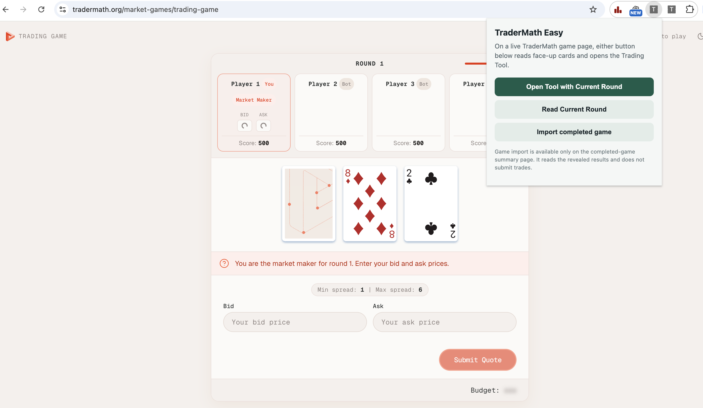
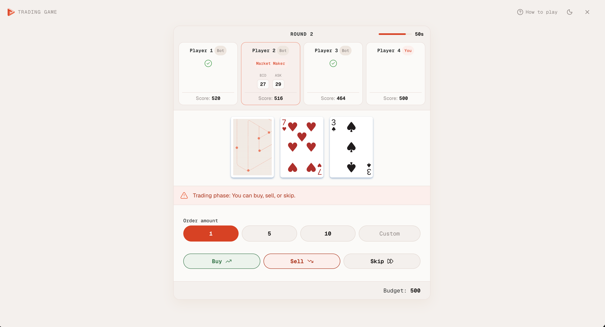
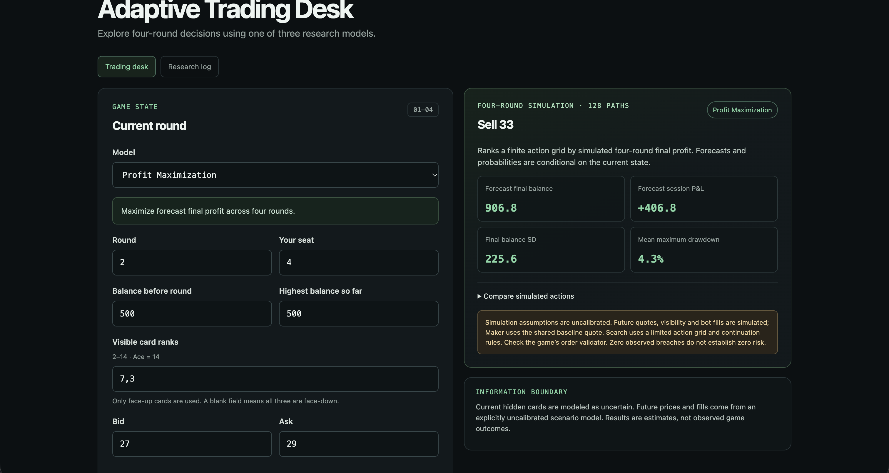
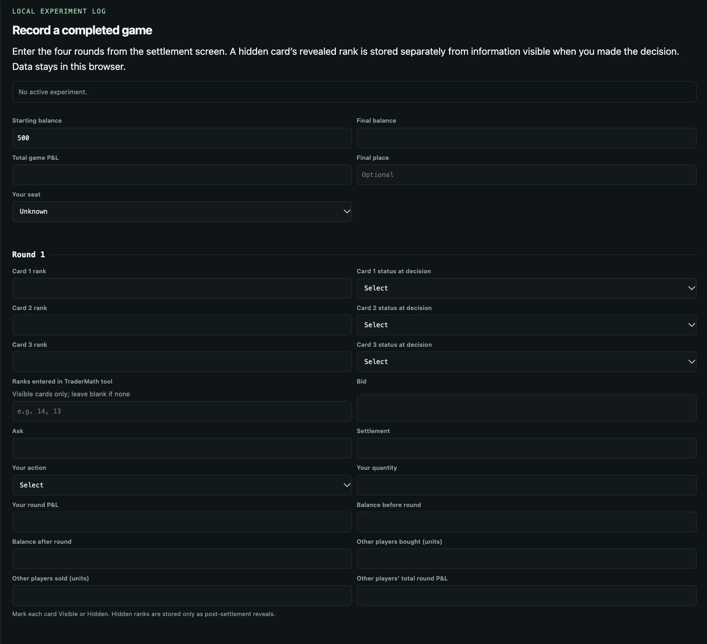
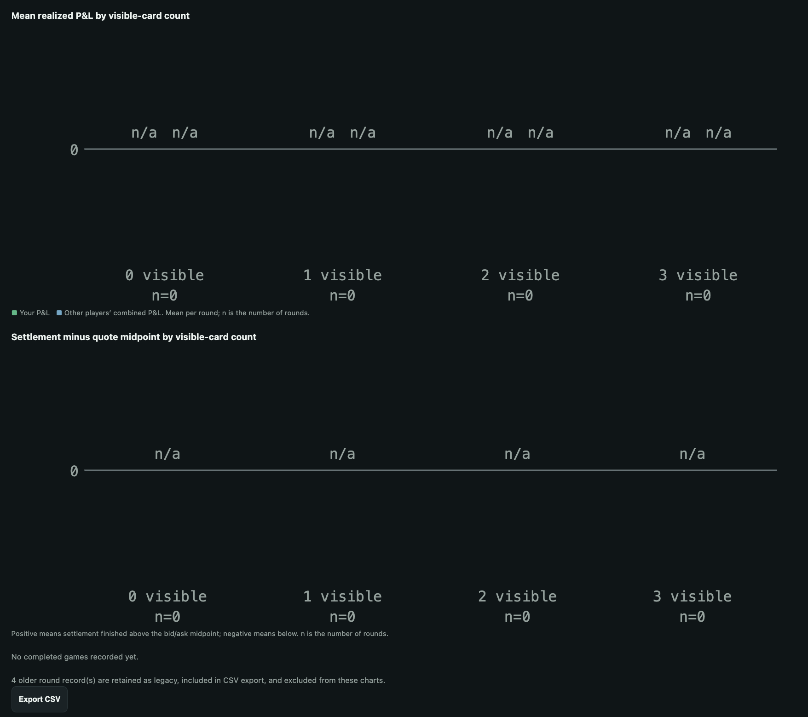
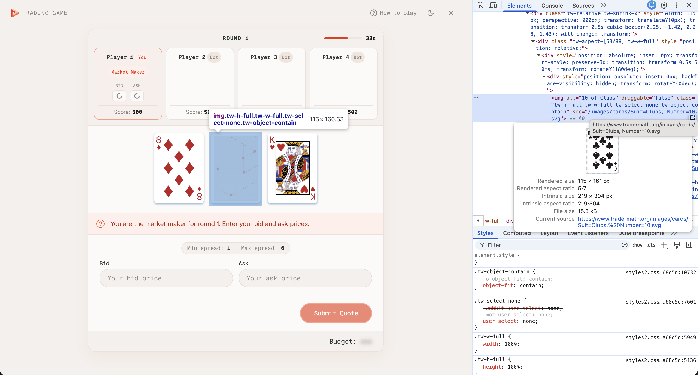
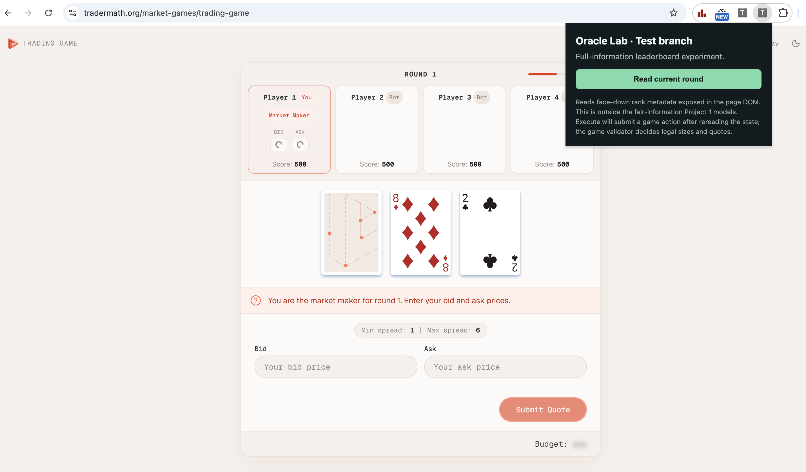

# Adaptive Trading Models in the TraderMath Trading Game

**Project 1 — Model and algorithm design**  
Victor Chen · TraderMath Market Games / Trading Game / Easy

This research project develops three quantitative decision models for a four-round trading game: **Profit Maximization**, **Risk-Adjusted**, and **Capital Preservation**. Each model uses the same decision-time information but has a different objective and approach to risk. The [research collection](research/README.md) contains assumptions, derivations, model flowcharts, limitations, and the original study. The [complete algorithm design](research/adaptive-trading-models/TraderMath_Adaptive_Algorithm.md) explains the common framework and all three models.

The [illustrated model examples](model-examples/model-examples.md) explain the tool’s interface, its metrics, and three real-round results.

## Project in action

**Page Reader browser extension:** A JavaScript extension reads the current game page and sends the detected face-up ranks and public round state to the Trading Desk. Its visibility checks were developed and tested using the page's DOM and rendering; they are rule-based, not a trained machine-learning model. Recognition depends on the website and must be checked against the game.

**Game context:** The third-party TraderMath interface shows the public cards and market quote that inform the decision.

**Trading Desk:** The Python-powered desk evaluates a game state and presents a model-specific action and simulated risk metrics. This screenshot shows the Profit Maximization view.

**Research log:** Completed-game fields distinguish cards visible at decision time from values revealed at settlement.

**Visibility analysis:** The interface groups round outcomes by visible-card count. This screenshot shows the empty state, with no completed games recorded; it is not an experimental result.

## Technical Highlights

- **Python decision engine:** Evaluates three distinct objectives using a finite action grid and simulated four-round paths, with model-specific metrics.
- **JavaScript browser extension:** Reads the game page's public round state and detects face-up cards using DOM and visibility checks, then passes the captured state to the Python-powered Trading Desk. A separate extension supports the Oracle Lab experiment.
- **Probability modeling:** Represents hidden-card uncertainty using independent-uniform ranks or a per-round 52-card model; live decisions are designed to use face-up information only.
- **Simulation and risk:** Estimates final profit, drawdown and threshold breaches under configurable, uncalibrated assumptions for future quotes and bot fills. A fixed seed makes the tool's simulation reproducible, not the live game.
- **Algorithm design:** Compares Profit Maximization, dynamically weighted Risk-Adjusted scoring and a finite-family Capital Preservation policy with ordered risk priorities.
- **Data integrity:** Separates decision-time visibility from post-settlement outcomes and documents the observed client-side exposure of a hidden card.
- **Experiment recording:** Provides browser-local completed-game records, CSV export and visualizations grouped by visible-card count; the screenshots above show an empty example rather than a completed dataset.

## Project Status

| Area | Status |
| --- | --- |
| Project 1 research | Three model specifications, assumptions, flowcharts and information-integrity investigation documented. |
| Trading Desk prototype | Python simulation and model-specific displays implemented as approximations; the normal page reader is designed to capture visible cards and requires continued live validation. |
| Data and calibration | Recorder and charts implemented; future quote and bot-response assumptions remain uncalibrated. Example screenshots are not a performance study. |
| Project 2 | Proposed, not started: build and validate a controlled environment for matched three-model and information-condition comparisons. |

The application source, extensions and experimental dataset are maintained privately. This public repository presents research, selected screenshots and illustrative examples.

## Information integrity and discovery

While building a trading assistant, unusually accurate apparent predictions prompted an investigation of the game's page. In the recorded round below, a card displayed face down had its rank and suit in the browser DOM before a quote was submitted. The post-game summary confirmed the same card.

The screenshot documents one observation; it does not establish the current state of the third-party website. Read the [Data Integrity and Information Leakage Prevention investigation](research/adaptive-trading-models/07-data-integrity-and-information-leakage-prevention.md) for the settlement confirmation, evidence excerpt, normal tool's information boundary, and Oracle Lab separation.

The normal tool is designed to capture face-up ranks automatically while excluding hidden ranks from live decisions. It depends on the site's rendering and requires continued real-game validation. The experimental Oracle Lab intentionally uses exposed current-card metadata and is not a fair-information model. The project does not claim to have repaired the third-party site.

**Oracle Lab browser extension:** This separate experimental extension illustrates the effect of the exposure by intentionally reading face-down card metadata when present in the page. Its results are kept separate from the normal models and are not evidence of fair-information performance.

## From exploration to Project 2

In a few exploratory Oracle Lab games, profitability appeared sensitive to particular card draws and opponent behavior, including maker bid and ask quotes. These informal observations do not quantify causal effects or establish a long-run winner. Because unmatched games can differ in cards, quotes, fills, and bankroll trajectories, they do not provide a controlled model comparison.

**Project 2 is proposed and has not started.** It will build and validate a controlled environment to compare all three frozen models on matched scenarios and to study partial information versus known current-round hidden cards. Action-dependent fills and bankrolls must be recomputed when strategies differ. Any future conclusions will depend on simulation validity and uncertainty.

The Python decision tool provides finite-grid, four-round rollout approximations under editable, uncalibrated assumptions about future quotes and bot behavior. It is not an exact solution of the research policies; its outputs do not guarantee performance.

This is an independent personal research project, not affiliated with or endorsed by TraderMath.
