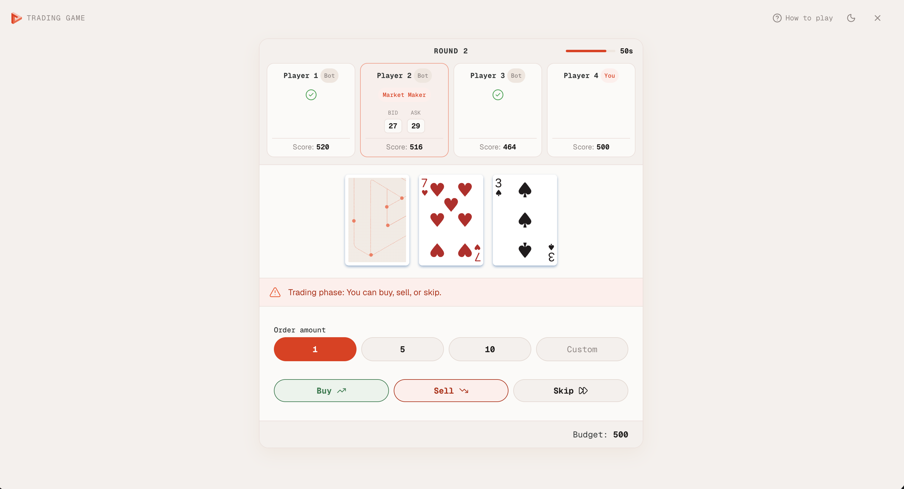
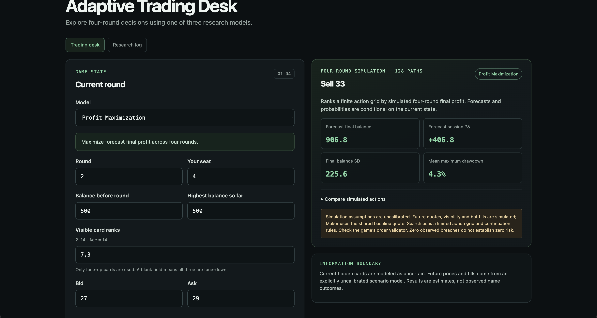
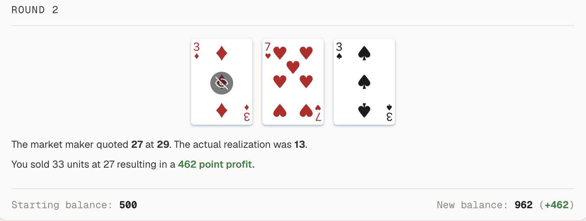
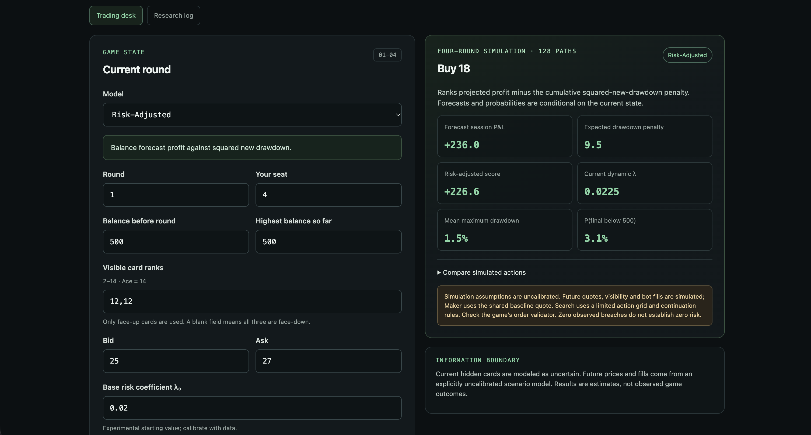
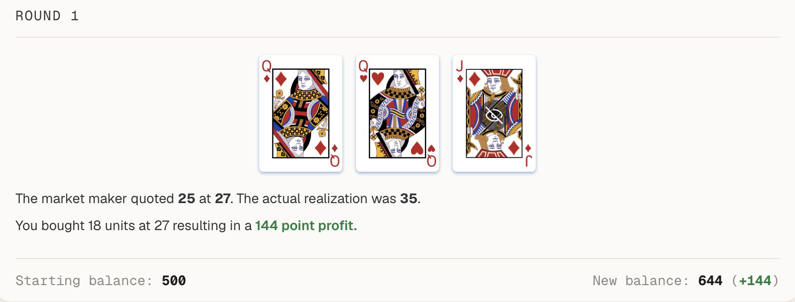
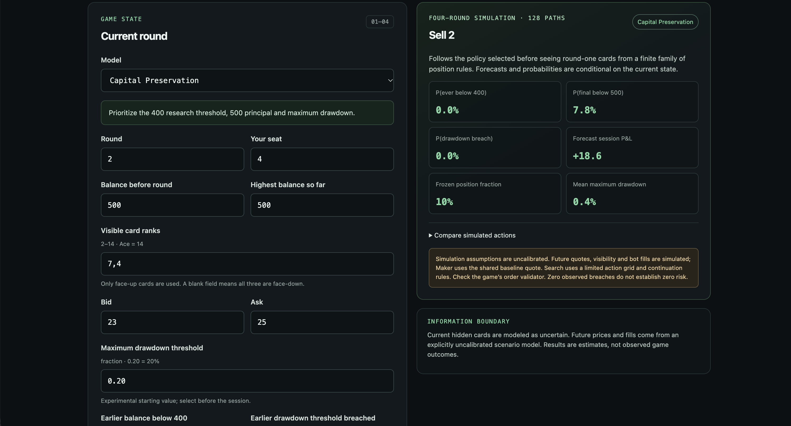
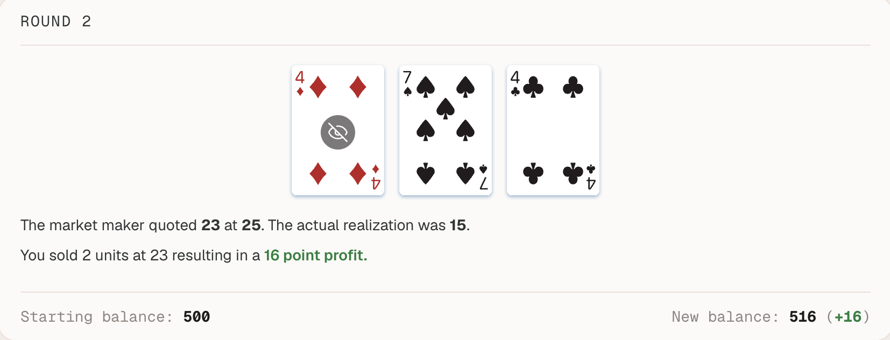

# Adaptive Trading Desk — Illustrated Model Examples

This document explains how the Project 1 Trading Tool processes game state, what its three model views mean, and how to interpret three real game examples. The screenshots show different game states: they **are not a controlled head-to-head comparison** of the models. The application and browser extension source code are private; these examples describe their observed and documented behavior.

## How the tool processes a game state

1. Open the hosted Adaptive Trading Desk and start a TraderMath Easy Trading Game. Select **Profit Maximization**, **Risk-Adjusted**, or **Capital Preservation**.
2. In the game, select the Page Reader extension's **Read current round** action. It automatically detects face-up ranks and sends them with the round, seat, balance and quote to the desk; there is no need to type the visible ranks during a successful capture. Check the captured state against the game before calculating. If capture fails or the displayed cards do not match, retry with the game and cards visible; do not treat an empty field as proof that all cards are hidden. The reader depends on the page's rendering and needs continued live-site validation.
3. Confirm the **highest balance so far**. It is needed to compute drawdown. On later rounds, earlier state may need to be supplied if no session capture is available.
4. Check the model-specific settings, then select **Run simulation**. Read the suggested action and results. The desk does not submit trades: a player must enter the order or quote in the game, whose validator determines whether it is accepted.
5. If using Capital Preservation, select and start the policy in round 1 before seeing its cards; preserve its frozen policy and risk history through the session. Completed-game outcomes can be recorded separately in the Research log.

### Shared inputs and information boundary

| Input | Meaning |
| --- | --- |
| **Round / Your seat** | Current round and player seat. When round equals seat the player is the market maker; otherwise the player is a taker. |
| **Balance before round** | Current game balance, including actual prior outcomes. |
| **Highest balance so far** | Actual peak balance reached before the decision; used to measure drawdown. |
| **Visible card ranks** | Only face-up ranks; 2–14, with J = 11, Q = 12, K = 13, A = 14. A blank is meaningful only if all cards are verified face-down. |
| **Bid / Ask** | Maker's current buying and selling quote when the user is a taker. A taker sells at the bid or buys at the ask. |

The live model treats face-down cards as unknown. In the baseline independent-uniform card model each unknown rank is modeled from 2 through 14; the alternative is a 52-card without-replacement model for each round. Hidden values revealed on the settlement screen are outcomes, not decision-time features. See the [information integrity investigation](../research/adaptive-trading-models/07-data-integrity-and-information-leakage-prevention.md).

## How to read the simulation

The default display uses **128 simulated paths**. Each starts from the current state, samples the current unknown settlement, simulates the remaining rounds, updates balance after each round, and summarizes the final outcomes. Future cards, visibility, quotes and bot fills use editable but **uncalibrated assumptions**; a seed controls the tool's simulation, not the live game's random seed. Forecasts are conditional on the current state and selected action.

For a taker, per-round payoff is `quantity × (settlement − ask)` for a buy, and `quantity × (bid − settlement)` for a sell. Forecast session P&L is simulated final balance minus the starting 500 points, so it includes the effects of earlier outcomes already reflected in the current balance. Final balance is an average across paths; it is not a prediction of the next settlement or a promised outcome. Mean maximum drawdown averages the largest peak-to-subsequent-balance decline along each simulated path. The displayed probabilities are proportions of simulated paths, not calibrated real-world probabilities; 0.0% observed in the simulation does not prove zero risk.

**Compare simulated actions** expands a table showing the finite candidate actions, forecast final P&L, risk score and below-400 frequency. Profit and Risk-Adjusted use a limited current-action grid and approximate future decisions. Capital Preservation uses one frozen rule from a limited family. The models do not solve the exact full policy described in the research. On maker rounds, all three currently use a shared expected-value-centered, spread-6 baseline quote and simulated bot fills; it is not an optimized or validated maker strategy. The site's actual order and collateral validator remains authoritative.

## Example 1 — Profit Maximization

The objective ranks the candidate current actions by simulated final profit. The game screenshot shows round 2, seat 4, balance 500, visible ranks 7 and 3, one hidden card, and bid 27 / ask 29.

| Display | Screenshot | Interpretation |
| --- | ---: | --- |
| **Sell** | 33 | Suggested taker action: sell 33 units at the bid, subject to the live validator. |
| **Forecast final balance** | 906.8 | Mean simulated balance at the end of round 4, conditional on the current state and action. |
| **Forecast session P&L** | +406.8 | Mean simulated final balance minus the opening 500. |
| **Final balance SD** | 225.6 | Standard deviation of simulated final balances, a measure of dispersion. |
| **Mean maximum drawdown** | 4.3% | Average of each simulated path's maximum drawdown. |

The settlement screenshot reveals the hidden card as 3, for a total of `3 + 7 + 3 = 13`. The game records a sale of 33 at 27: `33 × (27 − 13) = 462` points, taking the balance from 500 to 962. **+462 is the realized result for this round**, whereas +406.8 was a forecast for the complete session; they measure different horizons.

## Example 2 — Risk-Adjusted

This model ranks simulated profit after a penalty for cumulative squared new drawdown. It may trade less aggressively when the penalty outweighs expected profit. The screenshot shows round 1, seat 4, balance/peak 500, visible ranks 12 and 12, bid 25 / ask 27, and base coefficient λ₀ = 0.02.

| Display | Screenshot | Interpretation |
| --- | ---: | --- |
| **Buy** | 18 | Suggested taker action: buy 18 units at the ask. |
| **Forecast session P&L** | +236.0 | Simulated average final profit relative to 500. |
| **Expected drawdown penalty** | 9.5 | Average modeled cost of new drawdowns, not an actual fee. |
| **Risk-adjusted score** | +226.6 | Forecast profit minus the modeled penalty; displayed components are rounded separately. |
| **Current dynamic λ** | 0.0225 | Current risk coefficient; the base and dynamic parameters can be adjusted. |
| **Mean maximum drawdown** | 1.5% | Average maximum drawdown over simulated paths. |
| **P(final below 500)** | 3.1% | Share of simulated paths ending below the original 500. |

The revealed hidden jack made settlement `12 + 12 + 11 = 35`. The game records a purchase of 18 at 27: `18 × (35 − 27) = 144` points, taking balance from 500 to 644. This is one realized round, not validation of the session forecast or the assumed risk model.

## Example 3 — Capital Preservation

This model selects a position-fraction rule at session start from a finite set. Its simulated ranking prioritizes: (1) probability of ever falling below 400, (2) probability of ending below 500, (3) probability of exceeding the chosen drawdown threshold, then (4) expected profit. The 400 level is a research threshold, and the 20% drawdown setting shown here is an adjustable experimental assumption.

| Display | Screenshot | Interpretation |
| --- | ---: | --- |
| **Sell** | 2 | Suggested taker action: sell 2 units at the bid. |
| **P(ever below 400)** | 0.0% | No below-400 paths observed in this conditional simulation. |
| **P(final below 500)** | 7.8% | Share of simulated paths ending below initial principal. |
| **P(drawdown breach)** | 0.0% | No paths observed exceeding the selected 20% drawdown limit. |
| **Forecast session P&L** | +18.6 | Average simulated final profit relative to 500. |
| **Frozen position fraction** | 10% | The selected fixed fraction of the applicable estimated legal position cap, not 10% guaranteed loss. |
| **Mean maximum drawdown** | 0.4% | Average maximum drawdown across the simulated paths. |

The visible ranks were 7 and 4, with bid 23 / ask 25. The hidden 4 made settlement `4 + 7 + 4 = 15`. The game records a sale of 2 at 23: `2 × (23 − 15) = 16` points, taking balance from 500 to 516. A positive single-round result does not prove the selected policy protects principal in every game.

## What these examples do and do not show

The screenshots connect the inputs, suggested action and observed round outcome for three separate situations. They do not establish that any model will outperform another, and the observed P&L is not the simulation's forecast. Project 2 is proposed to test all three models on matched scenarios in a separately configured environment, including partial- and full-current-information conditions. It has not yet been carried out.
