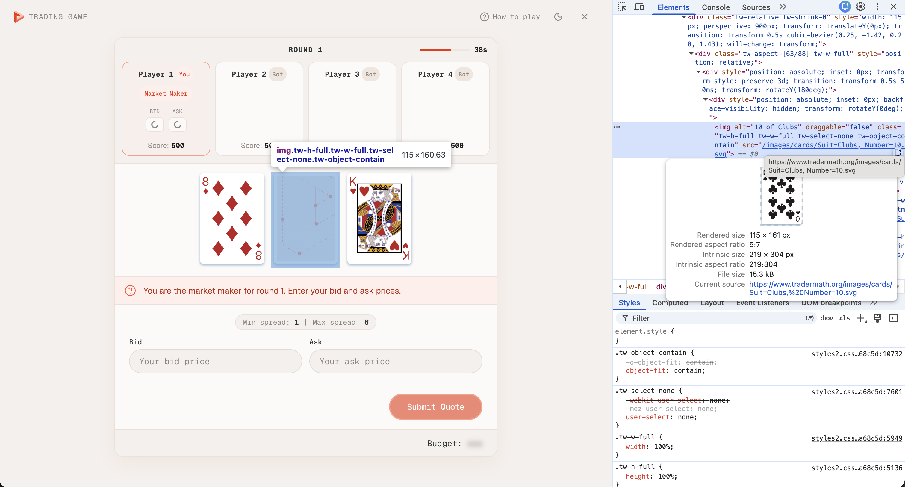
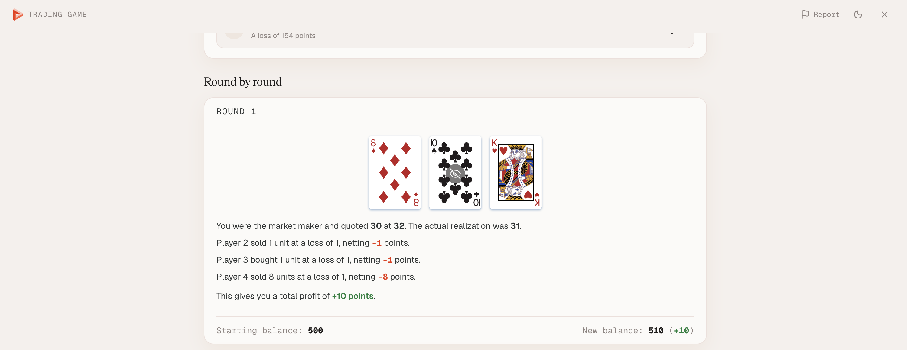
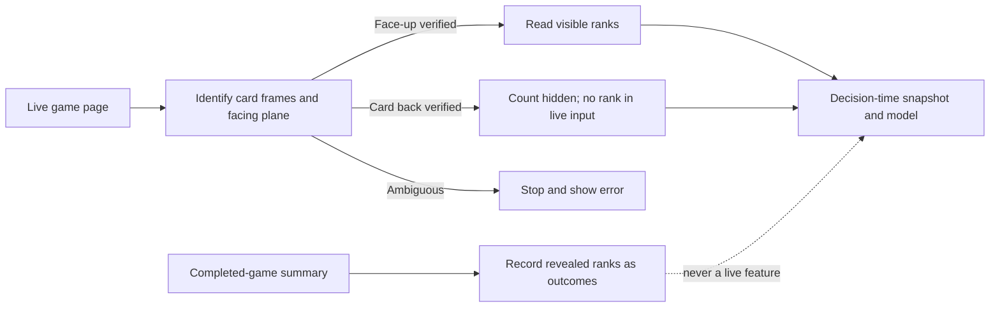

# Data Integrity and Information Leakage Prevention

**Project 1 — Adaptive Trading Models in the TraderMath Trading Game**

**Author:** Victor Chen

**Scope:** Easy Trading Game, decision-time information; observed 17 November 2026.

## The question that led to the discovery

The trading models are supposed to reason from the cards visible when a decision is made. A hidden card is a random variable, not an input. While building the original page reader, unusually accurate apparent predictions and zero settlement uncertainty when cards were face down raised a question: was the tool predicting those cards, or was information already present in the page? That observation prompted an inspection of the game's browser DOM. It is not, by itself, evidence that an algorithm is predictive or that all past results used leaked information.

## Observation: a face-down card had a face image in the DOM

In a Round 1 maker decision, the middle card appeared face down and the player had not yet submitted a quote. Chrome DevTools highlighted that card's location while the corresponding image element identified its front face:

```html

```

The card's rotating container and `backface-visibility: hidden` visually concealed the front face. They did not remove the image metadata from the DOM. Both the `alt` text and image URL exposed rank and suit to a page reader. This is **client-side information exposure**, not evidence of access to a server database or internal seed.



At the end of the same game, the Round 1 summary revealed the middle card as the ten of clubs, marked by the eye icon as hidden at decision time. The other cards were the eight of diamonds and king of hearts in both screenshots. The settlement value was 31, consistent with 8 + 10 + 13.



Together these observations support the exposure in this recorded round. They do not establish its frequency, current status on later site versions, or whether the site's server sends additional sensitive state. Preserve both screenshots with the game and round context; a pre-decision DOM value and the later outcome should never be conflated.

## How the normal tool avoids using it

The normal Page Reader is designed to capture the live page automatically, so users need not manually type the face-up ranks. It locates card-shaped image frames, calculates which image plane faces the viewer using the computed 3D transforms, and inspects rank metadata only for images judged front-facing. A front-facing card-back asset increments a hidden count; its face rank is not intentionally used as a live input. The resulting public ranks, round, seat, balance and quote are sent to the decision desk. This is DOM/geometry-based reading, **not OCR or screenshot image recognition**.

If there are not exactly three identifiable card frames, a face cannot be determined, or a visible rank is ambiguous, the reader returns an error rather than guessing. A legitimate all-hidden state can have zero visible ranks. Reliance on the site's rendering and geometry means changes, animations, occlusion or unusual layouts can defeat recognition or cause errors; the current implementation has not been revalidated end-to-end across live rounds. Inspect displayed ranks and counts before following any recommendation. It is a client-side guard, not a guarantee that the website itself protects hidden data.

At settlement, the separate completed-game import may record revealed ranks as **outcomes**, together with their decision-time visibility. These labels must be kept separate from the immutable decision snapshot; they must never flow back into the live features, policy selection, or training inputs for that same decision. Incomplete or unverified records should be excluded from analysis, rather than silently classified as zero visible cards.



## Oracle Lab: an isolated information experiment

The private Oracle Lab test branch contains a **separate extension** that intentionally reads face metadata from the current card frames, including face-down cards when exposed. Its purpose is to demonstrate the information boundary and explore a full-current-information benchmark; it is not the normal tool and is not evidence of a fair-information strategy's performance. Its implementation includes an optional execution control, and its sizing and maker assumptions are approximations. Neither a maximum leaderboard score nor successful live execution has been established. The screenshots above provide the direct evidence; the extension is an experimental illustration, not independent proof on every site version.

The vendor-side prevention is to withhold unrevealed rank and suit, including face assets and equivalent state, from the client until disclosure is permitted. A CSS-only hide is not an information boundary. The project does not claim to have fixed the third-party website or to know whether the finding has been reported or remediated.

## From the finding to Project 2

Project 2 is **proposed and not yet started**. It will build and validate a controlled environment so the three frozen models — Profit Maximization, Risk-Adjusted and Capital Preservation — can face matched exogenous card draws, visibility masks, starting balances, seats and opponent assumptions. A paired study can ask both how objectives compare and how information changes each model's outcomes:

In a few exploratory Oracle Lab games, the author's qualitative impression was that profitability was sensitive to the particular cards and other players' behavior, including market-maker bid and ask quotes. With few observations and no matched controls this is motivation for further testing, not an estimated causal effect or a measured ranking of models. Live games with unmatched scenarios cannot reliably isolate the effects of strategy and information.

| Information condition | At decision time | Research role |
| --- | --- | --- |
| Partial information | Public cards and public market state; hidden ranks remain unknown | Fair-information baseline for each of the three models |
| Full current-round information | Current hidden ranks revealed to the experimental model | Measure the effect of current-card information under identical scenarios |
| Perfect foresight, separately specified | Future exogenous states also known | Optional distinct benchmark, not equivalent to the current-card Oracle |

Hold fixed model version, rules, scenario seeds, and opponent/transition assumptions within matched pairs. Recompute action-dependent fills, balances and legal actions when a model chooses a different action; do not hold recorded outcomes fixed after changing decisions. Randomize or predefine scenario allocation, split calibration and evaluation by whole game, freeze parameters before holdout evaluation, and report paired differences with uncertainty. Compare mean and median final profit, loss and 400/500 breach frequencies, drawdown, tail outcomes and model behavior by visible-card count. Treat three-model differences and information effects as hypotheses until measured; neither the live screenshots nor Oracle Lab establish a long-run winner.

The published Project 1 desk uses finite-grid four-round rollout approximations and explicitly uncalibrated simulation assumptions; it does not solve the exact research policies or implement this future controlled comparison.
