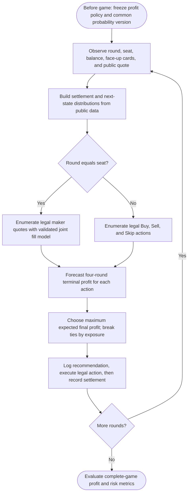
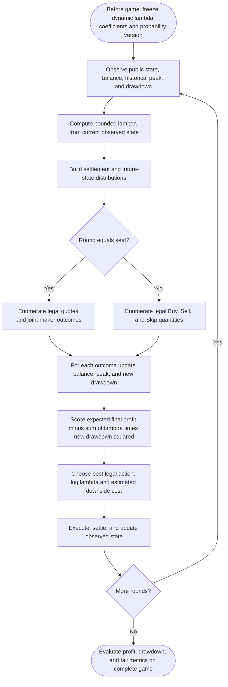
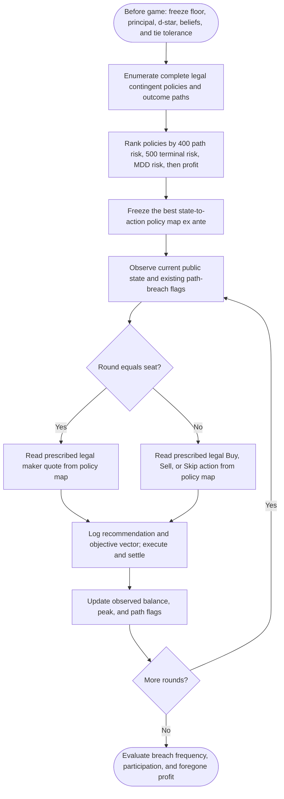

**Author:** Victor Chen  
**Affiliation:** Indiana University Bloomington · Kelley School of Business  
**Project:** Project 1 — Model and Algorithm Design<br>
**Project Type:** Independent Quantitative Research & Development  
**Research Areas:** Quantitative Trading · Algorithm Design · Computational Finance  
**Project Status:** Research specification; Project 2 has not started<br>
**Last Updated:** November 2026

**Research specification · Easy Trading Game · four-round sessions**

## 0. Research declaration and assumptions

### Declaration

This is **Project 1**, an independent study of model and algorithm design for the TraderMath Market Games → Trading Game → Easy level. It sets out three complete-session decision objectives, their mathematical inputs and payoffs, proposed decision procedures, computational requirements, and the evidence needed to evaluate them. The document is self-contained: its definitions, assumptions, examples, and formulas do not require the historical algorithm to remain available. The three policies are **research specifications**, not a claim that the current website tool exactly solves them or that any policy has been shown to outperform another.

The design separates information known **at decision time** from information revealed **after settlement**. A face-down card contributes uncertainty; its rank is never supplied to the live model, even if page metadata could expose it. Revealed hidden ranks may be retained as outcome labels for post-game calibration. The work uses the game's point balance as simulated capital and makes no claim about real-money trading performance. This project is not affiliated with or endorsed by TraderMath.

### Data integrity and information leakage prevention

In a documented Easy round, a face-down card's front image metadata was present in the DOM before a maker quote, and the post-game summary confirmed the exposed ten of clubs. The normal extension is designed to locate on-screen card frames, classify the facing image plane and extract ranks only from verified face-up cards; ambiguous recognition returns an error. It does not require manual entry of visible ranks when recognition succeeds. Its rendering-based classification remains dependent on the website and requires live validation; it does not repair the website. Post-settlement ranks are outcomes, never decision-time features. The separate Oracle Lab deliberately accesses exposed current-card metadata and must remain outside the normal model and performance records. See the [investigation and evidence](07-data-integrity-and-information-leakage-prevention.md) for screenshots, the distinction between information sets, and limitations.

### Assumption register

| ID | Working statement | Status and consequence |
| --- | --- | --- |
| A1 | An Easy session has four rounds, four seats, three cards per round, ranks 2–14 with Ace = 14, settlement equal to the three-rank sum, and initial balance 500. | Game structure used in this research; recheck when the website or settings change. |
| A2 | The player makes the market when round $r$ equals their seat $p$ and takes another maker's quote otherwise. | Confirmed by the user from the observed game; do not assume Maker is always round 4. |
| A3 | A hidden rank is initially modeled as independent and uniform on $\{2,\ldots,14\}$. | Provisional probability baseline, **not** an observed dealing rule. Compare with a physical-deck model using complete-game data. |
| A4 | The card sum is settled after each round and updates the displayed balance before the next decision. | Working transition assumption; if exposure persists between rounds, available-capital and state equations must include it. |
| A5 | The live website determines allowed prices, spread, quantities, short collateral, return-entry requirements, timer, and penalties. | Treat its validator as authoritative; any analytic size cap below is conditional on its stated rule. |
| A6 | A quoted price or bot identity may carry information about a hidden settlement or future bot fills. | Hypothesis requiring held-out predictive evidence; no bot is assumed to see hidden cards. |
| A7 | The 400-point line is a **research risk threshold** and 500 points is initial principal. | User-selected study definition; neither 400 nor the proposed risk priorities are asserted as game rules. |
| A8 | Each evaluated game uses a frozen probability model, response model, objective, and calibrated parameters. | Design requirement to prevent information leakage and after-loss retuning. |

In formulas, $P_\theta$ and $\widehat P_\theta$ denote **modeled** probabilities, not guaranteed true game probabilities. A candidate decision can be optimal under a fitted model while performing poorly if the model is misspecified. Unknown dealing, bot-response, and seed mechanics are therefore explicit limitations rather than silent assumptions.

## 1. Introduction

This document defines three distinct research policies: **Profit Maximization**, **Risk-Adjusted**, and **Capital Preservation**. All three use the same information available before a decision, card model, game rules, and legal action set. They differ in how they rank the distribution of complete four-round outcomes. The Python web tool provides finite-grid four-round simulation approximations of these objectives. Its transition assumptions are uncalibrated, and its rollout and restricted policy search do not solve these exact policies.

The Easy game considered here starts with 500 points, has four rounds and three cards per round, and uses their rank sum as settlement. The player in seat $p$ makes the market when the round number $r=p$ and takes another maker's quote in the other rounds. This role rotation follows the observed game and the user's confirmation. The exact dealing, cash, collateral, quote-price, penalty, and timer rules still need versioned observation before claiming a validated optimizer.

The primary research question in Project 1 is **how to specify and explain** three coherent decision models from the same observable state. It asks which outcomes each model prioritizes, how a change in balance or information changes its decision, and what assumptions are needed for a four-round policy to be computable. A good result in one game is evidence about that game only. A controlled performance comparison under identical scenarios is the proposed subject of **Project 2**, which has not started.

## 2. Mathematical definitions

### Game state and information

Let $r\in\{1,2,3,4\}$, seat $p\in\{1,2,3,4\}$, starting balance $B_0=500$, and realized round P&L $\Delta_r$. Then $B_r=B_{r-1}+\Delta_r$. Define the historical peak and fractional drawdown after round $r$ by

$$
H_r=\max_{0\le j\le r}B_j,\qquad D_r=\frac{H_r-B_r}{H_r},\qquad MDD=\max_{0\le j\le4}D_j.
$$

The pre-action state $s_r=(r,p,B_{r-1},H_{r-1},D_{r-1},I_r,\mathcal H_{r-1},\theta)$ includes the public information $I_r$ available on the screen, completed-round history $\mathcal H_{r-1}$, and frozen model version $\theta$. $I_r$ contains the *visible* ranks, observed quote on a Taker turn, displayed public bot data when available, and time remaining. A proposed Maker quote is an **action**, not a pre-action state feature. Hidden rank values and later-revealed outcomes cannot be live features. Available cash deducts open exposure only if the game actually carries positions across decisions.

Let $\mathcal F_r$ denote everything observable **before** action $a_r$. A legal policy is a mapping $\pi_r:\mathcal F_r\to\mathcal A(s_r)$, so two game histories that look identical at decision time must receive the same action under a deterministic policy. The complete-game law also includes unknown future cards, other makers' quotes, bot responses, and any later game penalties. The state must be rich enough for those modeled transitions; if a history variable predicts future quotes or bot behavior, include its public value and version its estimator. Do not insert the realized future into $s_r$ just to make a retrospective result look predictable.

For auditability, store each of the three card slots as a decision-time **visibility flag** and, only when face-up, a rank. A face-down slot has a known count and unknown rank. At settlement, store the revealed rank in a separate field. This representation prevents the later settlement screen from silently changing what the model supposedly knew when it acted.

### Settlement distribution and common belief

For $k_r$ visible card ranks $c_{r,1},\ldots,c_{r,k_r}$, let $S_r=\sum_j c_{r,j}$ and $h_r=3-k_r$. With hidden ranks $X_{r,1},\ldots,X_{r,h_r}\in\{2,\ldots,14\}$, the settlement is

$$
V_r=S_r+\sum_{j=1}^{h_r}X_{r,j},\qquad S_r+2h_r\le V_r\le S_r+14h_r.
$$

The independent uniform-rank **baseline** gives each hidden rank probability $1/13$. It implies $E[V_r\mid I_r]=S_r+8h_r$ and $\mathrm{Var}(V_r\mid I_r)=14h_r$ if the quote carries no additional information. A physical-deck model, persistence between rounds, or a quote-conditioned posterior may replace the baseline only after held-out validation. Every policy in a comparison uses the **same** selected posterior $P_\theta(V_r\mid I_r)$ and the same fitted future-state law $\widehat P_\theta(s_{r+1}\mid s_r,a_r)$.

The four visibility cases under this **baseline** are:

| Hidden count $h_r$ | Possible settlement | Conditional mean | Conditional variance |
| :-: | --- | ---: | ---: |
| 3 | 6 through 42 | 24 | 42 |
| 2 | $S_r+4$ through $S_r+28$ | $S_r+16$ | 28 |
| 1 | $S_r+2$ through $S_r+14$ | $S_r+8$ | 14 |
| 0 | Exactly $S_r$ | $S_r$ | 0 |

These means describe the **card baseline**, not what a bot quote means. Even when $h_r=0$ makes $V_r$ known, a position still has to pass the legal validator and a Maker quote still has uncertain bot fills. A card count alone never dictates a quantity.

### Legal actions, payoffs, and new drawdown

The website validator determines the legal action set $\mathcal A(s_r)$. On a Taker turn, an action is Skip or a legal quantity $q$ bought at ask $a$ or sold at bid $b$:

$$
\Delta_r^{buy}=q(V_r-a),\qquad \Delta_r^{sell}=q(b-V_r),\qquad \Delta_r^{skip}=0.
$$

Quantity $q$ is a nonnegative integer, with $q=0$ representing Skip. The quote satisfies $b<a$; screenshots of the selected Easy setting show a spread from 1 to 6 points, which is a **configuration observation**, not a timeless rule. If the site enforces cash affordability for a buy at positive ask, a provisional bound is $q\le\lfloor B_{r-1}/a\rfloor$. If it charges at least one point of short collateral per unit against upper settlement bound $U$, a provisional bound is $q\le\lfloor B_{r-1}/\max(1,U-b)\rfloor$. The site may use the global upper bound 42 or the visible-state bound $S_r+14h_r$; verify which one its validator actually applies. Neither formula overrides a displayed rejection or other funding rule.

On the Maker turn, choose a legal quote $(b,a)$. If bot $i$ buys $N_i^+$ units from our ask and sells $N_i^-$ units to our bid, its combined settlement payoff is

$$
\Delta_r^{maker}=\sum_{i=1}^{3}\left[N_i^+(a-V_r)+N_i^-(V_r-b)\right].
$$

All bots settle against the same $V_r$ and can respond jointly to a quote. Quote optimization therefore needs $P_\theta(V_r,Z_r\mid s_r,b,a)$ for the *joint* fill vector $Z_r$. Fills observed at one quote do not identify counterfactual fills at another. If that response law is not credible, all three models use the same predeclared baseline quote and Maker optimization is marked unavailable.

The transition model combines $\Delta_r$, any game penalty, the next balance, next public card display, next other-maker quote, and bot state. The planning horizon ends at $s_5$ after round 4. The terminal score and risk events are calculated from the **same propagated distribution** under a complete policy, not by evaluating each round in isolation.

Define **new drawdown in points** for a candidate round outcome by

$$
L_r=H_{r-1}(D_r-D_{r-1})_+,\qquad (x)_+=\max(x,0).
$$

This counts an increase in peak-relative drawdown after settlement, not all negative P&L. For example, a loss can increase $L_r$ even if the ending balance remains above 500. The final-session profit is $B_4-500$ points and the initial-capital return is $(B_4-500)/500$.

For Capital Preservation, define $F_r=\mathbf{1}[\min_{1\le j\le r}B_j<400]$ and $M_r=\mathbf{1}[\max_{1\le j\le r}D_j>d_*]$. They remain true after a recovery because they describe **path** events. Distinguish $P(F_4=1)$ from $P(B_4<400)$: a game can cross 400 and later finish above it. Likewise, a terminal profit can coexist with a large temporary drawdown.

## 3. Mathematical derivations

### 3.1 Conditional settlement and action distributions

Under the baseline, the exact probability of a total $v$ is the discrete convolution

$$
P_\theta(V_r=v\mid I_r)=\frac{1}{13^{h_r}}\sum_{x_1=2}^{14}\cdots\sum_{x_{h_r}=2}^{14}\mathbf{1}[S_r+\sum_jx_j=v].
$$

For $h_r=0$, interpret this as unit probability at $v=S_r$. Use this *entire* mass function, rather than only its mean, when forecasting tail events, collateral outcomes, and continuation states. For each legal Taker action, map each $v$ to $\Delta_r$, $B_r$, $H_r$, $D_r$, and $L_r$. For a Maker quote, integrate the **joint** $(V_r,Z_r)$ outcomes before updating those same state variables.

A rank uniform on the 13 integers from 2 to 14 has mean $(2+14)/2=8$ and variance $(13^2-1)/12=14$. Under independent hidden ranks, means and variances add, giving $\mu_r=S_r+8h_r$ and $\sigma_r^2=14h_r$. At $h_r=3$, direct enumeration considers $13^3=2{,}197$ rank tuples. The sum distribution is triangular/convolutional rather than uniform on its 37 possible totals; equal spacing of totals does **not** imply equal probability.

If the site deals physical cards **without replacement**, let $D_r^{deck}$ be the physical cards remaining after removing the publicly known cards, $\rho(c)$ a card's rank, and $\mathcal C_h(D)$ the set of all $h$-card subsets of deck $D$. The alternative conditional law is

$$
P(V_r=v\mid I_r)=\frac{1}{\binom{|D_r^{deck}|}{h_r}}\sum_{A\in\mathcal C_{h_r}(D_r^{deck})}\mathbf{1}[S_r+\sum_{c\in A}\rho(c)=v].
$$

Whether $D_r^{deck}$ resets each round or retains prior draws is another separate mechanism. Rank and suit logs after completed rounds can test these alternatives. A distribution fitted to one observed game is not enough to identify the dealing mechanism or the website's random-number seed.

For a Taker who observes another maker's quote $Q_r=(b_r,a_r)$, let $I_r^{card}$ denote the public card and other pre-quote information. A *candidate* quote-conditioned update is

$$
P(V_r=v\mid I_r^{card},Q_r)\propto P(Q_r\mid V_r=v,I_r^{card})P(V_r=v\mid I_r^{card}).
$$

The quote likelihood must be estimated on earlier settled games and improve held-out prediction after controlling for public cards, round, and maker identity. Otherwise use the card-only posterior. This rule tests whether quotes carry information; it does **not** assume a bot sees the hidden card. All three policies use whichever posterior is selected before evaluation.

### 3.2 Model 1 — Profit Maximization

For a complete legal policy $\pi$, maximize $E_\pi[B_4-500]$. A finite-state Bellman representation is

$$
J^{P}_5(s_5)=B_4-500,\qquad J^{P}_r(s_r)=\max_{a\in\mathcal A(s_r)} E_\theta[J^{P}_{r+1}(s_{r+1})\mid s_r,a].
$$

This model inserts no arbitrary loss penalty. A loss can still lower future opportunity because it changes the balance, legal sizes, and reachable states. A historical alternative set limits of $P(B_4<500)\le0.25$ and $P(B_4<400)\le0.05$; in this revision, those are **reported evaluation benchmarks**, not hidden constraints on Profit Maximization. Exact ties use smaller exposure and then a frozen canonical action order.

For a fixed Taker quote, let $\mu_r=E[V_r\mid\mathcal F_r]$ and $\sigma_r^2=\mathrm{Var}(V_r\mid\mathcal F_r)$. The immediate conditional moments are

$$
\begin{aligned}
E[\Delta_r^{buy}\mid\mathcal F_r]&=q(\mu_r-a),\\
E[\Delta_r^{sell}\mid\mathcal F_r]&=q(b-\mu_r),\\
\mathrm{Var}(\Delta_r^{buy}\mid\mathcal F_r)&=\mathrm{Var}(\Delta_r^{sell}\mid\mathcal F_r)=q^2\sigma_r^2.
\end{aligned}
$$

The per-unit expected edge is $\mu_r-a$ for a buy and $b-\mu_r$ for a sell. A positive edge makes immediate expected P&L grow linearly with legal $q$; variance grows as $q^2$. **The full-session profit objective is not merely this one-step edge.** If a loss reduces later legal size or changes the next quote distribution, two actions with the same current expected gain can have different $E[B_4-500]$. At round 4, with no future decision, the immediate expected P&L does determine the terminal mean, subject to legality and ties.

**Worked final-round Taker state.** Suppose $B_3=596$, two face-up ranks are 10 and 6, hidden rank $x$ is provisionally uniform from 2 to 14, and the observed quote is bid 26, ask 28. Selling $q$ units gives

$$
V_4=16+x,\qquad B_4=596+q(26-V_4)=596+q(10-x),\qquad E[B_4]=596+2q.
$$

At $q=24$, the worst modeled outcome is $B_4=500$, the mean is 644, and $P(B_4<500)=0$. At $q=37$, the worst outcome is 448, the mean is 670, and $P(B_4<500)=2/13$ because only $x=13,14$ cross below 500. If **both** quantities pass the live short collateral validator and no future round remains, Profit Maximization prefers 37 on expected terminal profit. The 37-unit cap follows one provisional collateral interpretation with global upper settlement 42; it is not a confirmed website limit. These probabilities are conditional on the already reached round-4 state, not full-session risk frequencies.

On the Maker turn $r=p$, Profit Maximization ranks candidate legal quotes by expected **terminal** profit under the joint $(V_r,Z_r)$ law, including how quote-dependent fills change future capital. When no validated response law supports a quote, the model cannot truthfully rank it; a frozen baseline quote is an explicit research fallback rather than an inferred optimum.

### 3.3 Model 2 — Risk-Adjusted

The user selected expected profit less **squared new drawdown** as the primary dynamic risk model:

$$
\max_{\pi}E_\pi\left[B_4-500-\sum_{r=1}^{4}\lambda(s_r)L_r^2\right].
$$

$\lambda(s_r)$ has units inverse points. A precommitted candidate function is

$$
\lambda(s_r)=\mathrm{clip}\left(\lambda_0+\theta_DD_{r-1}+\theta_C\frac{(500-B_{r-1})_+}{100}+\frac{\theta_R}{5-r},\lambda_{min},\lambda_{max}\right),
$$

with nonnegative, training-calibrated coefficients and declared bounds. The 100-point denominator only scales the capital-deficit feature; it does not turn 400 into a game rule. The parameter vector is frozen for a held-out game, while the function evaluates to a new value after the observed state changes. The recursion uses $J^{R}_5=B_4-500$ and

$$
J^{R}_r(s_r)=\max_{a\in\mathcal A(s_r)}E_\theta\left[J^{R}_{r+1}(s_{r+1})-\lambda(s_r)L_r^2\mid s_r,a\right].
$$

For a final-round illustration with $B_3=H_3=596$, visible ranks $10,6$, quote $26/28$, and a uniform hidden rank, selling $q$ has $E[\Delta_4]=2q$ and $E[L_4^2]=30q^2/13$. Its score is $2q-\lambda(30/13)q^2$, whose continuous maximizer is $13/(30\lambda)$ before rounding and legal limits. Thus a calibrated coefficient can produce an intermediate size. This is a mathematical illustration, not a fitted recommendation. CVaR and MDD are reported as diagnostics rather than stacked into the same objective.

The squared term comes from the four adverse hidden ranks $x=11,12,13,14$: their new drawdowns from the starting peak in this example are $q,2q,3q,4q$ points. Averaging the four squared losses over all 13 equally likely ranks gives $(1^2+2^2+3^2+4^2)q^2/13=30q^2/13$. If $\lambda=0$, the objective collapses to the Profit model in this reached state. As a **hypothetical illustration only**, $\lambda=0.02$ inverse points gives a continuous peak near $q=21.7$; an actual policy compares neighboring legal integers, Skip, Buy, and future outcomes rather than rounding blindly. For the two sizes above, $q=24$ scores higher than $q=37$ when $\lambda>26/1830\approx0.0142$ in this final-round example. Neither value of $\lambda$ is asserted to be calibrated.

The proposed state function raises its risk cost after observed drawdown or a fall below 500 **only when fitted coefficients for those terms are positive**. The coefficient $\theta_R/(5-r)$ can make the last-round penalty larger, but its usefulness is empirical rather than guaranteed. Coefficients, clipping bounds, and feature choices are selected from training sessions and frozen before held-out games. Variance and standard deviation penalize upside as well as downside; CVaR captures tail loss but can be noisy with sparse games and should be reported as an evaluation metric. Do not add variance, standard deviation, CVaR, and drawdown into one unexplained score.

On the Maker round, compute $L_r$ from the **combined** three-bot fill and settlement outcome, then propagate the state. A maker can lose on several fills simultaneously; evaluating each bot as a separate independent round understates shared risk. Without a validated joint response model, the same baseline maker quote is used by all three policies and no model-specific Maker advantage is claimed.

### 3.4 Model 3 — Capital Preservation

Let $d_*$ be a predeclared drawdown threshold. The user confirmed **400 points as a research risk threshold**, not an asserted game cutoff. For a complete policy define

$$
\begin{aligned}
C_1(\pi)&=P_\pi(\min_{1\le r\le4}B_r<400),\\
C_2(\pi)&=P_\pi(B_4<500),\\
C_3(\pi)&=P_\pi(MDD>d_*),\\
C_4(\pi)&=-E_\pi[B_4-500].
\end{aligned}
$$

Select the **lexicographic minimum** of $(C_1,C_2,C_3,C_4)$: compare the first component, move to the second only within a predeclared numerical tie tolerance, then to the third, and finally to profit. This preserves the priority of avoiding a 400 breach and then loss of initial principal without multiplying incomparable probabilities and points by invented weights. State tracking includes whether the 400 or drawdown event already occurred, so a later recovery does not erase a path breach. A strict zero-tolerance version can skip too often; calibrate tolerance and compare with a safety-set alternative on held-out games.

The ordering is intentional. A policy with lower $P(\min B_r<400)$ wins even if its expected profit is lower, unless the difference falls within a **predeclared** tie tolerance $\varepsilon_1$. Only then compare $P(B_4<500)$ within $\varepsilon_2$, followed by $P(MDD>d_*)$ within $\varepsilon_3$ and expected profit. The three tolerances are probability-scale numerical/statistical choices, not a license to change priorities after observing a bad game. Record the full vector for each candidate, including which priority decided the action.

This is an **ex ante complete-policy choice**, made before the first card is dealt. A lexicographic path objective can be time-inconsistent if it is freshly optimized after a breach: once a 400 breach has occurred, every continuation has $C_1=1$ conditional on that history, so a new local ranking could discard the original trade-offs. Select and version a contingent policy map at $s_1$, then execute the map's action for each later public state. Re-estimating beliefs or parameters mid-game creates a new intervention and must be evaluated as a separate policy. If exact ex ante search is computationally infeasible, an approximate policy must state its approximation and measure any objective gap; a succession of unrelated local rankings is not an implementation of this model.

In the worked final-round state above, both selling 24 and selling 37 have zero modeled chance of ending below 400. Selling 24 has $P(B_4<500)=0$, whereas selling 37 has $2/13$. With equal prior path flags and a tie tolerance smaller than $2/13$, Capital Preservation ranks 24 ahead of 37, **even though** 37 has the higher mean. It may still prefer another smaller size or Skip after all legal candidates and the drawdown priority are considered. If a 400 breach already occurred earlier, the path event flag remains true; the committed policy's remaining priorities still need to be evaluated consistently.

The Maker turn is not automatically risk-free: a spread constrained by the game can leave unavoidable adverse outcomes. Capital Preservation searches quote-dependent joint fill distributions when validated; otherwise its Maker turn follows the same baseline quote as the other models. Report the feasibility of its safety goals, trade participation, and foregone expected profit. A policy that skips nearly every optional trade needs to be identified as such, not presented as a free improvement.

### 3.5 Maker adverse selection and policy commitment

$E[\Delta_r^{maker}\mid b,a]$ is **not** obtained by multiplying expected fills by $a-E[V_r]$ or $E[V_r]-b$ unless fill and settlement are conditionally independent. Bots may trade precisely when the quote is unfavorable. Integrate $P_\theta(V_r,Z_r\mid s_r,b,a)$ and retain covariance. Before a game, freeze the selected policy, probability version, Maker baseline/response law, and calibration. If the decision rule is recomputed at a reached state, follow that committed state-contingent policy; a new after-loss objective would invalidate the ex ante comparison.

Write $N^+=\sum_iN_i^+$, $N^-=\sum_iN_i^-$, and $\mu_r=E[V_r\mid\mathcal F_r]$. Rearrangement and the covariance identity yield, conditional on the same state and candidate quote, with every expectation and covariance conditioned on $(s_r,b,a)$:

$$
\Delta_r^{maker}=N^+a-N^-b+(N^--N^+)V_r,
$$

$$
E(\Delta_r^{maker})=E(N^+)(a-\mu_r)+E(N^-)(\mu_r-b)+\mathrm{Cov}(N^--N^+,V_r).
$$

The covariance term is a measurable adverse-selection channel. If bots buy more when the settlement is high or sell more when it is low, it tends to be negative. That pattern **does not by itself prove hidden-card access**: it can arise from public signals, quote selection, or a misspecified model. To test it, condition on visible cards, maker identity, quote, and other public history; then check predictive performance on later games. A quote of 22 at 28 with realized $V_r=18$, two bot buys of one unit each, and one bot sell of one unit produces $2(28-18)+(18-22)=16$ points of maker profit. That is one realized result, not an expected return or an optimality proof.

If both buy and sell responses remain possible for any settlement in $[S_r+2h_r,S_r+14h_r]$, a quote guaranteed not to lose **on either single-side fill** requires $b\le S_r+2h_r$ and $a\ge S_r+14h_r$. Its spread must be at least $12h_r$. With one hidden card, this is 12 points, larger than the observed Easy spread maximum of 6. Hence a no-loss quote is generally infeasible in that configuration; risk management cannot be replaced by merely widening the spread. A centered spread-2/4/6 grid is an **exploration design** for gathering response data, not an optimal quote claim.

### 3.6 Complete-session probability and commitment

Let $d_r^\pi(s)=P_\pi(s_r=s\mid s_1)$ be the occupancy probability of a reachable pre-action state under a fixed policy. A fitted transition law propagates it by

$$
d_{r+1}^\pi(s')=\sum_s d_r^\pi(s)\widehat P_\theta(s'\mid s,\pi(s)),\qquad r=1,2,3,4.
$$

The expected final profit, terminal principal-loss probability, and 400 path-breach probability are all summaries of this **same** propagated distribution, with path flags carried in $s_5$. For example,

$$
E_\pi[B_4-500]=\sum_{s_5}d_5^\pi(s_5)(B_4(s_5)-500),\quad P_\pi(B_4<500)=\sum_{s_5}d_5^\pi(s_5)\mathbf{1}[B_4(s_5)<500].
$$

An ex ante risk statement starts at $s_1$ before any cards, quotes, or outcomes are known. A displayed probability after reaching round 4 is conditional on that reached state and is **not** an ex ante four-round guarantee. A precommitted policy can adapt to a new visible card or balance without changing its objective or fitted parameters. Replacing the policy after a loss with a freshly tuned one changes the evaluated intervention and must be logged as a different policy version.

## 4. Algorithm logic

### 4.1 Inputs, outputs, and invariants

| Item | Required meaning |
| --- | --- |
| Session input | Model choice $m$, seat $p$, initial balance 500, game/rules version, probability-model version $\theta$, calibrated parameters, and training/evaluation assignment. |
| Round input | Current round, pre-action balance, peak and drawdown, decision-time visible-card flags and ranks, observed quote if Taker, public bot state, timer, and website-legal actions. |
| Candidate output | For every legal action: a projected next-state and final-balance distribution; profit, new-drawdown cost, and/or preservation priority vector as required by $m$. |
| Decision output | Recommended legal action, quantity or quote, reason for ranking, model version, and timestamp. Actual submitted action is stored separately. |
| Information invariant | The live calculation never receives a face-down rank, later fill, final settlement, future quote, or future seed value. |
| Comparison invariant | All three models use the same cards, public observations, legal-action rules, and fitted transition/response model when compared. Only the objective changes. |

### 4.2 Shared round procedure

1. **Freeze the research design.** Before the game choose one of the three models, seat, model version, Maker fallback, training/evaluation assignment, tie rules, and calibrated parameters. The model objective remains fixed for all four rounds.
2. **Capture an immutable public snapshot.** Record round, seat, balance, peak, drawdown, visible card ranks and count, observed Taker quote, available displayed public bot data, legal actions, and clock. Do not use hidden-card metadata or post-settlement ranks.
3. **Form one shared belief.** Calculate $P_\theta(V_r\mid I_r)$ and, if validated, the joint Maker fill law and next-public-state transitions. Use the same laws for all three policies.
4. **Construct legal policies.** Enumerate Taker Skip and legal Buy/Sell quantities; on the Maker round $r=p$, evaluate legal quotes only when a validated response law covers them, otherwise use the shared baseline. For Capital Preservation, construct and compare complete contingent policies **before round 1** and freeze the selected state-to-action map.
5. **Propagate full four-round outcomes.** For every candidate policy, update bankroll, peak, drawdown, path-breach flags, future legal actions, and terminal-balance distribution. Avoid replacing a full distribution with expected value alone. Profit and Risk-Adjusted can use Bellman continuation values at a reached state; Capital Preservation follows its ex ante map there.
6. **Apply the locked objective.** Profit maximizes expected terminal profit. Risk-Adjusted subtracts expected state-dependent squared new drawdown. Capital Preservation uses its precommitted priority vector and declared tie tolerance. Keep recommendation, estimated distribution, and manually executed action distinct in the record.
7. **Settle and evaluate separately.** After each round, record actual fills, revealed ranks tagged post-settlement, signed P&L, penalties, new balance, peak, and drawdown. After the fourth round, record final place and outcome. Fit new versions only on training games, then evaluate frozen versions on untouched complete sessions.

### 4.3 Model-specific action ranking

**Profit Maximization:** compute the expected terminal value $E[B_4-500\mid s_r,a]$ for every legal candidate under one continuation policy; choose the highest. If two candidates have the same modeled value within declared numerical precision, choose lower exposure and then the frozen canonical order. At the last round this reduces to maximizing expected immediate round P&L, but earlier rounds require future-state forecasts.

**Risk-Adjusted:** evaluate the same terminal profit distribution plus each possible outcome's incremental $L_r^2$ and the later state-dependent penalties. Compute $\lambda(s_r)$ from the *pre-action* public state; do not change it merely because one candidate outcome is worse. Select the action with greatest expected profit net of the expected sum of squared-new-drawdown costs. Record $\lambda$, the profit component, and the risk-cost component so a reviewer can reproduce the ranking.

**Capital Preservation:** before the game, propagate the path flags and obtain $(C_1,C_2,C_3,C_4)$ for each complete candidate policy. Compare components in fixed order using predeclared numerical tolerances, and freeze the winning contingent policy map. At each reached public state, use the action prescribed by that map. Record whether the ex ante ranking was decided by 400-path risk, 500-terminal risk, peak drawdown, or expected profit. This model is allowed to Skip even a positive-edge trade if that trade worsens a higher-priority risk measure.

### 4.4 Algorithm pseudocode

```text
INPUT: model m, seat p, frozen beliefs and response law, calibrated parameters
       website-legal action oracle, game rules version, starting balance 500
STATE: balance, historical peak, drawdown, prior path flags, completed public history
BEFORE round 1, if m is Capital Preservation:
    compare complete contingent policies ex ante by the frozen lexicographic vector
    freeze the chosen state-to-action map and its tie tolerances
FOR round r = 1, 2, 3, 4:
    observe decision-time public state and verify each card's visible/hidden flag
    if m is Capital Preservation:
        read the prescribed legal action from the frozen ex ante policy map
    else:
        if r == p:
            enumerate legal quotes only when joint bot-response coverage exists
            otherwise use the common predeclared baseline quote
        else:
            enumerate website-legal Skip, Buy(q), and Sell(q)
        for each candidate:
            integrate current unknown settlement and any joint Maker fills
            update balance, peak, drawdown, and path flags for each outcome
            propagate later public-state and legal-action distributions to round 4
            evaluate the frozen objective for m over complete policies
        choose the best legal candidate by the frozen objective and tie rule
    log recommendation and modeled components before the action
    record actual action separately; after settlement log revealed outcome and P&L
AFTER round 4:
    reconcile final balance and place; retain complete/incomplete status
    fit only on training games and evaluate only frozen versions on held-out games
```

This is the intended research algorithm. In particular, “propagate later public-state distributions” requires a calibrated transition law; the Python tool uses an explicitly uncalibrated scenario model and finite continuation rules rather than a calibrated transition law or an exact optimizer. Its recommendations are conditional simulation estimates, not perfect foresight.

## 5. Algorithm workflow

All three diagrams use a common start: freeze the policy and read only decision-time public information. They branch on the actual seat-based role and return to the same outcome record. The distinct model objective appears inside each flow.

### 5.1 Profit Maximization workflow



If the joint Maker response law is unavailable, node P4 uses the same declared baseline quote as the other models and labels that turn unoptimized.

### 5.2 Risk-Adjusted workflow



Lambda changes with the observed state through a **frozen** function; its coefficients are not refitted during the game. Without a Maker response law, node R5 uses the shared baseline quote.

### 5.3 Capital Preservation workflow



The safety priorities and contingent map stay fixed even after a loss. Without a Maker response law, the ex ante map uses the common baseline quote on that role and does not claim optimized protection.

## 6. Computational complexity

Let $h_r\le3$, $K_r\le12h_r+1\le37$ possible settlement totals, $Q_r$ legal Taker actions, $M_r$ candidate legal Maker quotes, and $F_r$ joint bot-fill outcomes. Let $|\mathcal S_r|$ be the number of represented reachable states, $A_r$ maximum actions per state, and $T_r$ next-state outcomes per state/action. These are state-space counts, not constants supplied by the four-round horizon.

| Calculation | Time | Working memory | Scope |
| --- | --- | --- | --- |
| Baseline card distribution by direct rank enumeration | $O(h_r13^{h_r})$ | $O(K_r)$ | At most 2,197 three-card tuples |
| Baseline card distribution by convolution | $O(13\sum_{j=0}^{h_r-1}(12j+1))$ | $O(K_r)$ | Reuse intermediate count arrays |
| One round of Taker action distributions | $O(Q_rK_r)$ | $O(Q_r+K_r)$ | Once the settlement distribution is cached |
| One round of Maker quote distributions | $O(M_rK_rF_r)$ | $O(M_r+K_rF_r)$ | Constant-time joint-model queries assumed |
| Backward optimization of Profit or Risk-Adjusted on an explicit finite state set | $O(\sum_{r=1}^{4}|\mathcal S_r|A_rT_r)$ | $O(\sum_r|\mathcal S_r|)$ | Risk-Adjusted state includes peak/drawdown; fitting cost excluded |
| Capital Preservation policy search | Representation dependent | Representation dependent | Exact ex ante lexicographic path probabilities may require policy-level search or augmented state/risk budgets |

For $h=3$, direct enumeration uses $13^3=2{,}197$ rank tuples; basic convolution count updates total $13+169+325=507$. If cards are dealt without replacement, enumerate or dynamically count the remaining physical deck instead. Maker response fitting and inference costs cannot be stated until their model class is chosen. Capital Preservation's lexicographic objective should not be described as a simple one-round $O(QK)$ ranker: it compares whole-session path events under one policy and one ex ante information set. Exhaustive deterministic search over $S=\sum_r|\mathcal S_r|$ explicit states with at most $A$ actions has at most $A^S$ policies, an upper bound for that *particular brute-force method*, not a claimed inherent runtime.

Peak and path flags enlarge the Risk-Adjusted and Capital Preservation states relative to a balance-only Profit model. The exact size depends on how balances, quotes, bot histories, and drawdown are discretized. An approximation that prunes low-probability states may speed evaluation but can erase rare 400-breach outcomes; it must preserve or bound omitted probability mass. The algorithm must finish before the game's decision deadline, so runtime and memory should be measured on representative states after a model class is chosen. Training the card, transition, and Maker-response laws has separate cost and belongs between games, not inside the timed live path.

## 7. Validation and limitations

### 7.1 Randomness and unstable game conditions

The game's card deal, visible/hidden pattern, other makers' quotes, and bot response can vary from one session to another. A pseudorandom generator and seed may be involved, but **the exact website seed mechanism and whether a seed can be controlled are unverified**. Project 1 therefore cannot claim that a Profit game and a Risk-Adjusted game on the live website faced the same hidden cards or quotes. An observed difference in final profit mixes policy effects with scenario variation, seat, changing bot behavior, player practice, and execution errors. A few very profitable games do not isolate an algorithmic advantage.

Even if a common seed were available, changing a quote may change bot fills, and changing a trade changes bankroll and later legal quantities. “Same seed” is **not sufficient** to assume identical subsequent observed states. A valid paired experiment needs the same **exogenous random inputs** plus an explicit structural response rule that recomputes action-dependent fills and transitions. The future controlled comparison described in Section 8 will address this; no such environment exists yet in this project.

### 7.2 Probability and mechanism uncertainty

Confirm whether ranks are independent, dealt from a 52-card deck, reset each round, or retained. Check whether suits and prior visible cards predict later settlements. Verify whether quotes contain information beyond public cards and whether fills are correlated with settlement after controlling for the public state. Wrong assumptions change tail probabilities and can reverse action rankings. The fitted transition and joint Maker-response models may be unreliable at rarely observed quotes; extrapolated quote performance must be labeled uncertain. The website's quote, funding, collateral, timer, and penalty rules may change, so record the active rules version and use the live validator as authoritative.

### 7.3 Observation, execution, and data integrity

Record each card's visibility and rank **before** the action. A card back is not a visible rank even if browser metadata contains it. After settlement, append revealed ranks only as labels. Log the recommendation, actual order/quote, time remaining, fills, signed P&L, penalties, balance, and reason when execution differs from the recommendation. Audit completeness and visible-card counts before training. An interrupted game is not a completed four-round observation; retain it with an exclusion reason and report exclusions by model. Manual return entry, invalid quantities, and timeouts are performance variables, not ignorable noise.

### 7.4 Calibration and statistical uncertainty

Use earlier complete games to fit card likelihoods, future-state transitions, joint bot responses, $\lambda$ coefficients, $d_*$, and tie tolerances. Split by **whole game**, because rounds share bankroll and opponents. Freeze versions before held-out evaluation and prevent post-settlement ranks or Oracle outputs from becoming decision features. Report mean and median final profit, profit SD, downside deviation, MDD, 400 path-breach and 500 terminal-loss frequencies, tail quantiles/CVaR when estimable, participation, penalties, and uncertainty intervals. An observed zero breach count does not prove zero risk. A model can look better on the data used to tune it and worse in a new game.

### 7.5 Oracle and implementation boundaries

A post-import Full-Information Oracle may know the *current* revealed $V_r$ but not future exogenous outcomes. A Perfect-Foresight Oracle additionally needs a clearly defined future-information set and a structural model for action-dependent bot fills and legal sizes. Neither is obtained by replacing one recorded action with another while holding all later states fixed. Oracle-only values never enter normal live decisions. The current Python tool simulates conditional four-round estimates and a shared Maker baseline; it does not solve the exact three four-round policies. The flowcharts are mathematical designs, not deployed bot behavior.

## 8. Improvements and future Project 2

### 8.1 Project boundary

**Project 1 (this repository's current study):** specify the three models, their shared information and payoff kernel, assumptions, algorithms, data-integrity requirements, and limitations. It may use completed live games to check mechanics and calibrate provisional beliefs. Its comparison table describes how objectives differ **mathematically**; it does not establish which policy earns more in a controlled experiment.

**Project 2 (proposed; not started):** build and validate a reproducible Easy-game environment, then compare the three **frozen** Project 1 policies on matched scenarios. It is a separate future empirical study, not an already implemented simulator, dataset, or result. Any claim that one model is “best long term” belongs to that measured study, with its simulator validity and uncertainty reported.

In addition to comparing the three objectives under partial information, test a matched full-current-information condition in which the current hidden ranks are revealed. This estimates the effect of current-card information separately for each policy. Perfect foresight of future rounds is a different optional benchmark. Recompute counterfactual action-dependent fills and bankrolls; the results remain hypotheses until a validated study is run.

### 8.2 Proposed controlled environment

Reconstruct the verified game mechanics: three-card settlement, information mask, role rotation, legal-action validator, balance updates, maker quotes and joint bot responses, penalties, and terminal scoring. Give each matched scenario an explicit seed controlling exogenous card draws and other exogenous randomness. Run all three models with the **same initial seat, opening balance, rules version, visible-card pattern, exogenous draws, and frozen opponent/response mechanism**. Each receives the same decision-time public information and is never shown hidden ranks before settlement. Action-dependent fills and later bankrolls must be recomputed, so trajectories may legitimately diverge after different actions.

Use common random numbers across models to reduce scenario variance, not to force identical actions or post-action states. Separate training seeds from untouched evaluation seeds. Fit card, quote, response, and risk-parameter models only on training scenarios; freeze all versions for the paired evaluation. First validate that the simulator reproduces observable distributions from real completed games—card totals, visible counts, quote/spread patterns, fill frequencies, and round P&L—before treating its model ranking as evidence about TraderMath.

### 8.3 Proposed three-model comparison

For evaluation scenario $g$, record each model's complete four-round result $Y_g^m$ and a paired difference, for example $D_g^{R,P}=Y_g^{Risk}-Y_g^{Profit}$. Compare mean final profit, median profit, initial-capital return, MDD, $P(\min B_r<400)$, $P(B_4<500)$, lower-tail outcomes, Maker/Taker performance, and trade participation. Use confidence intervals **clustered by scenario** or a paired bootstrap over seeds. Keep an independent unpaired live-game check to measure simulator-to-site mismatch. Predefine the main comparison and a practically meaningful effect size before seeing evaluation outcomes; do not choose a winning model from the best-looking slice after the fact.

Candidate hypotheses are: Profit Maximization has the highest mean but greater downside; Risk-Adjusted reduces drawdown without giving up too much mean profit; Capital Preservation lowers 400-path and 500-terminal breach frequencies but may skip more trades. These are **hypotheses**, not conclusions. Project 2 should report contrary results, sensitivity to the bot-response model and $\lambda$ calibration, and any cases where the simulator is not credible.

## 9. Notation and research status

| Symbol | Meaning |
| --- | --- |
| $r,p$ | Current round and player's seat; the player is Maker when $r=p$. |
| $B_r,H_r,D_r,MDD$ | Balance after round $r$, historical peak, fractional drawdown, maximum session drawdown. |
| $I_r,\mathcal F_r,\mathcal H_{r-1}$ | Current public observation, all pre-action information, and completed prior-round history. |
| $k_r,h_r,S_r,V_r$ | Visible count, hidden count, sum of visible ranks, and three-card settlement. |
| $b,a,q$ | Bid, ask, and Taker quantity. |
| $N_i^+,N_i^-,Z_r$ | Bot $i$ buys from our ask, sells to our bid, and the joint bot-fill outcome. |
| $L_r,\lambda(s_r)$ | New drawdown in points and its state-dependent risk coefficient. |
| $d_*,F_r,M_r$ | Predeclared MDD threshold and path-breach flags. |
| $\pi,\theta,\widehat P_\theta$ | Complete legal policy, frozen fitted-model version, and estimated transition law. |

The [research collection](../README.md) indexes the supporting audit, standalone model specifications, comparison framework, validation plan, original manuscript, and historical algorithm. They add provenance and detail, but **none is required to read or derive the current algorithm**. Project 2 remains a future proposal. The tool's three model views are approximate implementations under stated assumptions, not evidence that the exact policies have been solved or validated.
