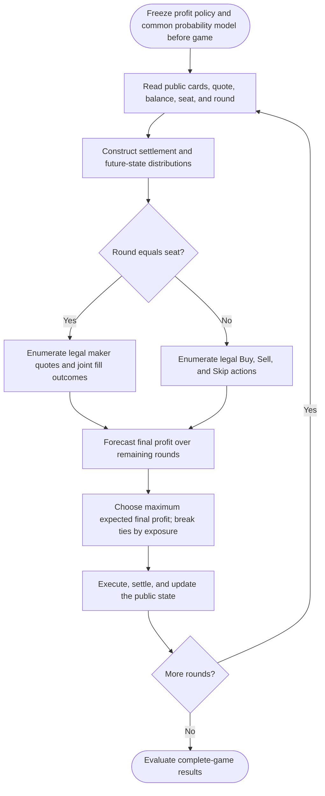

# Model 1 — Profit Maximization

**Status:** the Python desk implements a four-round finite-grid rollout approximation of this objective. It samples future states under uncalibrated assumptions and uses a fixed continuation heuristic; it does not solve the exact Bellman policy below. Maker uses the shared baseline quote.

The mathematical rule and flowchart in this document describe the research target; the deployed approximation is described separately above and in the [model examples](../../../model-examples/model-examples.md).

## Mathematical decision rule

For a common fitted transition law and website-legal action set $\mathcal A(s)$, define $J_5(s_5)=B_4-500$ and

$$
J_r(s)=\max_{a\in\mathcal A(s)}\sum_{s'}\widehat P(s'\mid s,a)J_{r+1}(s'),\qquad r=4,3,2,1.
$$

Choose an attaining action; break exact ties by smaller exposure, then a fixed canonical action order. This maximizes expected *final* profit, not the current round's expected P&L. The state includes balance, seat, public cards/quote, prior completed outcomes, and any predictive public bot data. Future states and hidden ranks enter only through probabilities. This model has no invented risk penalty; legal funding and the effect of a loss on future legal actions are genuine constraints. A positive one-round edge can still be rejected if it destroys more valuable future opportunities.

On a Taker round, enumerate Skip and every validator-legal Buy/Sell quantity. For each settlement $v$, compute the corresponding $B_r$ with the original payoff formula and continue from that next state. A quote $(b,a)$ changes both edge and legal size. On the Maker round $r=p$, enumerate legal $(b,a)$ and integrate the **joint** distribution of $V$ and all three bot fills. With no validated response model, use a frozen baseline quote rule and label Maker decisions unoptimized; do not infer response from the observed quote alone.

The policy is dynamic because a newly observed quote, card, balance, or remaining-round count changes the continuation value. It does not change objective after a loss. All policy version and parameter choices are frozen before an evaluation game.

## Worked Taker calculation

In a final-round example with $B_3=596$, visible ranks $10,6$, one independent uniform hidden rank $x\in\{2,\ldots,14\}$, and quote $26/28$, selling $q$ gives $B_4=596+q(10-x)$ and $E[B_4]=596+2q$. A *provisional* global short collateral cap would allow up to $q=37$; the website validator must confirm legality. Thus $q=37$ has mean $670$, minimum $448$, and $P(B_4<500)=2/13$; $q=24$ has mean $644$ and minimum $500$. The profit model chooses $37$ **if** both sizes pass the live validator and no later opportunity remains. It does not interpret its risk metrics as ex ante four-round guarantees.

## Algorithm workflow



Without a validated Maker response model, the Maker branch uses the shared baseline quote and is labeled unoptimized.

## Pseudocode

```text
freeze common belief and transition model before the session
for each reachable state in rounds 4, 3, 2, 1:
    enumerate website-legal actions for that state's actual Maker/Taker role
    integrate settlement, joint fills if Maker, and future public states
    value[action] = expected continuation terminal profit
    policy[state] = best value, using declared exposure tie break
in live game: look up policy at observed public state, log recommendation
after settlement: update balance and state; never retrain within evaluation game
```

**Limitations:** an inaccurate transition model can make a seemingly optimal action harmful; sparse Maker quote data make many candidate quotes unsupported; full state enumeration may be expensive. Report model coverage and decision uncertainty rather than claiming a validated optimal policy.
