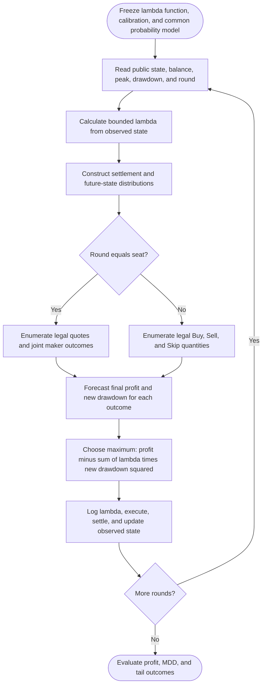

# Model 2 — Risk-Adjusted

**Status:** user-selected primary dynamic risk objective; no risk-adjusted policy is implemented in the live tool. Coefficients and the probability model remain uncalibrated.

## Risk measure selection

Variance of final profit penalizes upside and downside symmetrically. Standard deviation is its square root and should not be combined with variance as a second penalty. Loss probability ignores severity. CVaR at a low quantile captures severe loss but is noisy with few manually played games; a one-step CVaR penalty is homogeneous in quantity and can produce all-or-nothing final-round sizing. Current drawdown is a *state* measure, while maximum drawdown is a *path* outcome. The selected primary objective uses squared **new drawdown in points** per round. It is directly computable from modeled next balances, is convex in an adverse position size, and allows intermediate quantities. Report CVaR and final MDD separately as validation metrics; do not add every correlated measure to the objective.

Let $H_{r-1}$ and $D_{r-1}$ be the historical peak and current fractional drawdown before the decision. After a candidate outcome, set $H_r=\max(H_{r-1},B_r)$, $D_r=(H_r-B_r)/H_r$, and

$$
L_r=H_{r-1}(D_r-D_{r-1})_+\quad\text{points};\qquad R_r(s,a)=E[L_r^2\mid s,a]\quad\text{points}^2.
$$

The policy maximizes

$$
E_\pi\left[B_4-500-\sum_{r=1}^{4}\lambda(s_r)L_r^2\right].
$$

$\lambda(s)$ has units inverse points. Precommit the bounded state function

$$
\lambda(s_r)=\mathrm{clip}\left(\lambda_0+\theta_D D_{r-1}+\theta_C\frac{(500-B_{r-1})_+}{100}+\frac{\theta_R}{5-r},\lambda_{min},\lambda_{max}\right).
$$

Here $\lambda_0,\theta_D,\theta_C,\theta_R,\lambda_{min},\lambda_{max}\ge0$ with $\lambda_{min}\le\lambda_{max}$ are *calibration parameters* in inverse points, not chosen numerical values; the 100-point denominator scales the distance from initial balance 500 to the 400-point research risk threshold into a dimensionless variable. At each round λ changes only after observing a new public state; it is fixed while evaluating that round's candidate actions. Clipping and a frozen parameter vector limit oscillation. Capital deficit and drawdown are correlated, so coefficient fitting needs regularization and sensitivity analysis. Compare this combined function with fixed λ and individual capital/drawdown/remaining-round components on held-out games. If it merely tracks noise, retain the simpler function.

Bellman recursion uses stage reward $-\lambda(s)L_r^2$: $J_5=B_4-500$ and $J_r(s)=\max_a E[J_{r+1}(s')-\lambda(s)L_r^2\mid s,a]$. This is a precommitted dynamic policy, not a new objective invented after a loss. A larger drawdown increases the proposed penalty only if calibrated $\theta_D>0$; the policy may still take a favorable action if expected final improvement exceeds additional downside cost.

## Trading and making a market

Enumerate the same legal Taker quantities as Model 1. For each possible $V$, calculate $B_r,H_r,D_r,L_r$ and continuation value. On the Maker round $r=p$, use the shared joint $P(V,Z\mid s,b,a)$ for each legal quote; the downside penalty must include the *combined* three-bot fill outcome. Without a validated response model, use the common baseline quote and report the Maker risk estimate as unavailable.

In a final-round example, start at $B_3=H_3=596$, with visible ranks $10,6$, one hidden rank uniformly distributed on $\{2,\ldots,14\}$, and sell $q$ at bid 26. Then $E[\Delta]=2q$ and $E[L_4^2]=(1^2+2^2+3^2+4^2)q^2/13=30q^2/13$. The conditional objective is $2q-\lambda(30/13)q^2$ and its continuous optimum is $13/(30\lambda)$, clipped and rounded over the website-legal integers. This demonstrates how a calibrated λ could prefer an intermediate size. No particular λ or quantity is asserted as empirically best.

## Algorithm workflow



The lambda coefficients remain frozen during a game; the value of the function changes only when the observed state changes. Without a validated Maker response model, the Maker branch uses the shared baseline quote.

## Pseudocode

```text
freeze common belief, response model, lambda function and calibration
at each state: compute lambda from pre-action balance, peak, drawdown and round
for each legal Taker action or Maker quote:
    integrate all current outcomes, including joint fills on Maker turns
    propagate balance, peak and drawdown
    score expected terminal profit minus expected sum of lambda * new-drawdown^2
choose maximum; log lambda, estimated downside cost and selected action
```

**Trade-off:** this model sacrifices some expected profit when squared downside cost outweighs it. High λ can overprotect and miss profitable recovery; low λ becomes the profit model. Both risks are measured out of sample, with parameters selected on training games only.
