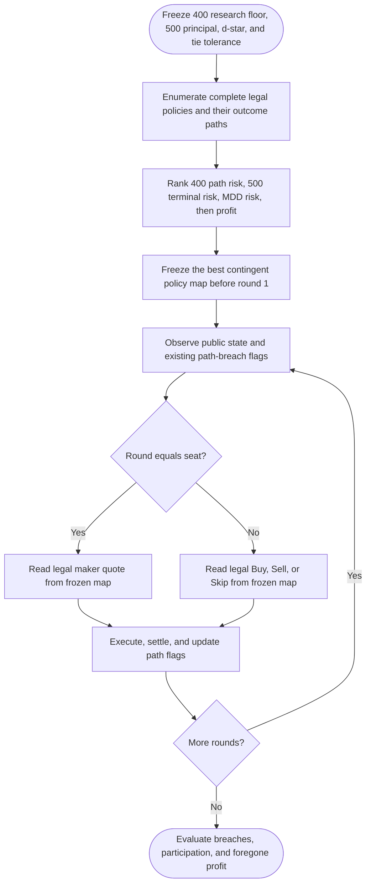

# Model 3 — Capital Preservation

**Status:** selected safety-first research policy. The 400-point line is a user-confirmed research risk threshold, not a confirmed game rule. The drawdown threshold and numerical tie tolerance still require calibration.

## Lexicographic objective

For a complete legal policy $\pi$, define

$$
C_1(\pi)=P_\pi\left(\min_{1\le r\le4}B_r<400\right),\quad C_2(\pi)=P_\pi(B_4<500),\quad C_3(\pi)=P_\pi(MDD>d_*),\quad C_4(\pi)=-E_\pi[B_4-500].
$$

Select a policy that lexicographically minimizes $(C_1,C_2,C_3,C_4)$: compare breach probability of the research floor first; only ties advance to terminal principal-loss probability, then calibrated peak-drawdown threshold $d_*$, then expected profit. This choice treats the path below 400 as serious even if later recovery finishes above 400. It avoids arbitrary weights with incompatible units. $d_*$ is predeclared from training and sensitivity analysis; no value is asserted here. Numerical comparisons need a predeclared tolerance based on estimation uncertainty, otherwise microscopic probability differences can dominate profit. The exact tolerance is an open research decision, not silently selected.

Track the path flags $F_r=\mathbf{1}[\min_{1\le j\le r}B_j<400]$ and $M_r=\mathbf{1}[\max_{1\le j\le r}D_j>d_*]$ in the state. **Choose the complete contingent policy ex ante**, before round 1, and freeze its state-to-action map. At a reached public state, follow that map rather than freshly optimizing the lexicographic vector: after a 400 breach, $C_1$ is already one for every continuation, so local reoptimization can abandon the original commitment. The frozen map still responds to observed capital, peak, visible cards, and remaining opportunities. A deterministic skip in every Taker round is a possible but testable failure mode, especially with an unavoidable Maker round. The policy may take risk-free positive-edge trades and trades that reduce a forced Maker shortfall probability; report participation rate explicitly. A tolerance-based safety set followed by expected profit is a candidate alternative if strict lexicographic priority degenerates.

All three models use the same Taker and Maker payoff equations and legal validator. Maker quotes require the common joint bot-response law. If it is unavailable, Maker turns use the same predeclared baseline quote and cannot be credited to preservation optimization.

## Worked Taker comparison

In a final-round example with $B_3=596$, visible ranks $10,6$, one hidden rank uniformly distributed on $\{2,\ldots,14\}$, and bid 26, both $q=24$ and $q=37$ sell sizes have $P(B_4<400)=0$ under the provisional distribution. Yet $q=24$ has $P(B_4<500)=0$ while $q=37$ has $2/13$. Thus Capital Preservation ranks $q=24$ ahead of $q=37$ if both are legal and their prior-path flags are equal. It may rank a smaller or skipped action still higher; the example establishes only this pairwise comparison. The result changes if the live collateral rule excludes a size or the posterior differs.

## Algorithm workflow



Without a validated Maker response model, the Maker branch uses the same baseline quote as the other two models and is not claimed to optimize protection.

## Pseudocode

```text
before round 1, freeze floor, principal threshold, drawdown threshold,
    beliefs, response law, and tie tolerance
enumerate complete website-legal contingent policies
for each policy, propagate outcome distributions and path flags to round 4
compute probabilities of ever crossing 400, ending below 500,
    crossing peak-drawdown threshold, and expected final profit
select lexicographic minimum with predeclared numerical tolerance
freeze and version the winning state-to-action map
in each reached round, use that map's prescribed legal action
record each component and whether the action was a forced Maker quote
```

**Trade-off:** strong principal protection can forgo upside and may fail to protect the floor when Maker risk is unavoidable. The evaluation must report feasibility, number of trades, foregone expected profit, and intervals around rare-event probabilities rather than calling a zero observed breach rate a guarantee.
