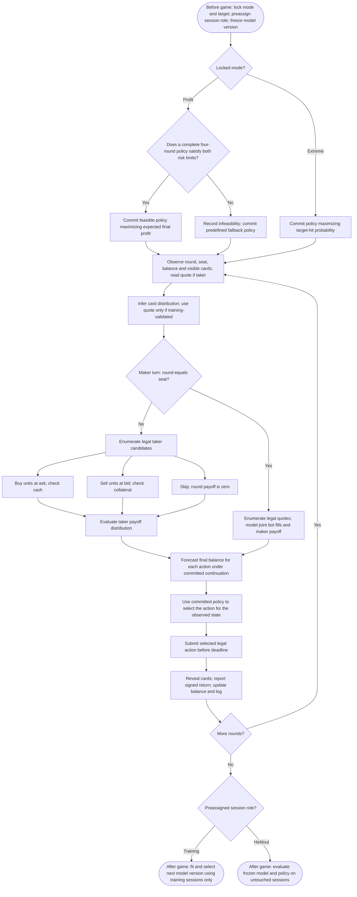

---

title: "A Quantitative Decision Framework for Trader Math Market Games"

sidebarTitle: "Trader Math algorithm"

description: "A modular research project beginning with the four-round Easy Trading Game, with future extensions to other games and difficulty levels."

---

**Author:** Victor Chen

**Affiliation:** Indiana University Bloomington · Kelley School of Business

**Project Type:** Independent Quantitative Research & Development

**Research Areas:** Quantitative Trading · Algorithm Design · Computational Finance

**Project Status:** Ongoing Research and Development

**Last Updated:** November 2026
---

**Research specification · Easy Trading Game · four-round sessions**

## 1. Introduction

The aim is to make decisions that can be explained, reproduced, and tested across complete games. In the Easy setup considered here, three cards determine a round's settlement value. Four rounds start with a balance of 500. The player makes a market once, in the round corresponding to their seat, and trades against another market maker's quote in the other three rounds. A decision therefore depends on both the hidden cards and the changing balance, while a market-making decision additionally depends on how the other three bots respond to a quote.

Before a session, the player selects one of two objectives. **Profit mode** seeks high average final profit while controlling the probabilities of finishing below the starting balance and of losing more than 100. **Extreme mode** seeks the highest probability of reaching or exceeding a target final balance fixed before play. Both modes use the same probability model, available actions, and session record; they differ in how they rank possible outcomes. The action is reconsidered as each round reveals new information, but the selected mode and Extreme target remain fixed for the entire session.

This document specifies a **research design**, not a demonstrated leaderboard strategy. The existing Python prototype calculates last-round market-taking outcomes under one provisional card model and settles already observed maker fills. Predicting bot responses, solving the complete four-round decision problem, and interacting with the website remain separate implementation and validation work. The card dealing and collateral rules also need to be confirmed experimentally.

## 2. Mathematical definitions

### Game state and information

Let the round be $$r\in\{1,2,3,4\}$$, the player's seat be $$p\in\{1,2,3,4\}$$, and the balance **before** round $$r$$ be $$B_{r-1}$$, with $$B_0=500$$. Under rotational market making, the player quotes in round $$r=p$$ and takes a quote otherwise. The decision state is

$$

s_r=\bigl(r,\,p,\,B_{r-1},\,H_r,\,Q_r,\,\mathcal H_{r-1},\,m,\,T\bigr).

$$

Here $$H_r$$ comprises the visible cards; $$Q_r=(b_r,a_r)$$ is an observed bid and ask when another player makes the market, and $$Q_r=\varnothing$$ on the player's maker turn; $$\mathcal H_{r-1}$$ is the record of **completed** rounds available at decision time; $$m\in\{\mathrm{Profit},\mathrm{Extreme}\}$$ is the mode; and $$T$$ is the fixed target in Extreme mode. On the maker turn the player chooses $$(b,a)$$ **as an action**, so the not-yet-chosen quote is excluded from the pre-action state. Known bot identities and balances can be included in the state when they are displayed and predictive. Future card faces, quotes, trades, and outcomes are excluded.

If $$\Delta_r$$ is the realized gain or loss from round $$r$$, then

$$

B_r=B_{r-1}+\Delta_r, \qquad B_4=500+\sum_{r=1}^{4}\Delta_r.

$$

Thus the legal quantity in any round is computed from the **current** balance, and a loss also changes the available bankroll in later rounds.

### Card value and uncertainty

Cards have ranks from 2 through 14, with an ace worth 14. In a round with $$k_r$$ visible cards, define their rank sum $$S_r$$, the hidden count $$h_r=3-k_r$$, the hidden ranks $$X_{r,1},\ldots,X_{r,h_r}$$, and the settlement value

$$

V_r=S_r+\sum_{j=1}^{h_r}X_{r,j}.

$$

The support implied by the visible ranks is

$$

L_r=S_r+2h_r \le V_r \le S_r+14h_r=U_r^{\mathrm{vis}}.

$$

Let $$P_r(v)=\Pr(V_r=v\mid\mathcal I_r)$$ be the distribution given the information $$\mathcal I_r$$ available **before** the action. Its mean and variance are $$\mu_r=\mathbb E[V_r\mid\mathcal I_r]$$ and $$\sigma_r^2=\operatorname{Var}(V_r\mid\mathcal I_r)$$. A quote from a bot may be part of $$\mathcal I_r$$ if evidence shows that it carries information about hidden ranks.

Under the initial independent-rank assumption derived below, the four information cases are:

| Hidden cards $$h_r$$ | Conditional range of $$V_r$$ | Mean | Variance |

| :-: | :-: | :-: | :-: |

| 3, no visible cards | $$6$$ to $$42$$ | $$24$$ | $$42$$ |

| 2 | $$S_r+4$$ to $$S_r+28$$ | $$S_r+16$$ | $$28$$ |

| 1 | $$S_r+2$$ to $$S_r+14$$ | $$S_r+8$$ | $$14$$ |

| 0, all cards visible | $$S_r$$ | $$S_r$$ | $$0$$ |

These cases change the probability of each possible settlement; the quote and final objective still determine whether and how much to trade.

### Quotes, actions, and bot fills

A quote $$(b,a)$$ has bid $$b$$ and ask $$a$$, with $$b<a$$. The selected Easy configuration has an allowed spread of 1 to 6 points; use the limits actually displayed if the configuration changes. On a market-taking turn, the player can buy $$q\ge 1$$ at $$a$$, sell $$q\ge 1$$ at $$b$$, or skip with $$q=0$$. On a market-making turn, the player chooses a legal $$(b,a)$$.

For bot $$i\in\{1,2,3\}$$, let $$N_i^+$$ be the units the bot **buys from us** at our ask and $$N_i^-$$ be the units it **sells to us** at our bid. A skip has both quantities zero. All three fills in a round settle against the **same** $$V_r$$; their combined outcome must be modeled as one joint round event.

## 3. Mathematical derivations

### 3.1 The settlement distribution

The initial, testable card model assigns each hidden rank independent probability $$1/13$$ for every value in $$\{2,\ldots,14\}$$. Conditional on the visible ranks,

$$

\Pr(V_r=v\mid H_r)

=\frac{1}{13^{h_r}}

\sum_{x_1=2}^{14}\cdots\sum_{x_{h_r}=2}^{14}

\mathbf 1\!\left\{S_r+\sum_{j=1}^{h_r}x_j=v\right\}.

$$

With no hidden cards, the sum above is interpreted as a single outcome $$V_r=S_r$$. A discrete convolution of the hidden-card distribution gives the same probability mass function. Since a uniform rank from 2 to 14 has mean 8 and variance $$(13^2-1)/12=14$$, independence gives

$$

\mu_r=S_r+8h_r,\qquad \sigma_r^2=14h_r.

$$

For three hidden cards this model gives $$\mu_r=24$$, but a mean alone does not describe the chance of a large loss. The full distribution $$P_r(v)$$ is used for sizing, downside probabilities, and target-hit calculations. In particular, neither “one hidden card” nor “three hidden cards” specifies a trade size by itself: the quote and bankroll also matter.

Independence is a modeling assumption, **not** a claim about the website's deck. If the cards are dealt without replacement from a standard 52-card deck, let $$D(H_r)$$ be the remaining physical cards, $$\rho(c)$$ be card $$c$$'s rank, and $$A$$ be an unordered selection of the $$h_r$$ remaining hidden physical cards. The alternative distribution is

$$

\Pr(V_r=v\mid H_r)

=\frac{1}{\binom{|D(H_r)|}{h_r}}

\sum_{\substack{A\subseteq D(H_r)\\ |A|=h_r}}

\mathbf 1\!\left\{S_r+\sum_{c\in A}\rho(c)=v\right\}.

$$

If cards are retained between rounds, $$D(H_r)$$ must additionally exclude prior revealed cards; if the deck resets each round, it must not. Recorded ranks and suits can distinguish these models on completed games.

When another bot quotes $$Q_r$$, a quote-conditioned posterior is appropriate **only if** the quote has verified predictive value after conditioning on public cards and relevant history. Bayes' rule gives the candidate update

$$

\Pr(V_r=v\mid H_r,Q_r,\mathcal H_{r-1})

\propto

\Pr(Q_r\mid V_r=v,H_r,\mathcal H_{r-1})

\Pr(V_r=v\mid H_r,\mathcal H_{r-1}).

$$

The likelihood must be learned from previously completed rounds; the revealed value $$v$$ cannot be an input to a live decision.

### 3.2 Taking a quote: edge, risk, and position size

For settlement at $$V_r=v$$, the gain from buying or selling $$q$$ units is

$$

\Delta_r^{\mathrm{buy}}=q(v-a),\qquad

\Delta_r^{\mathrm{sell}}=q(b-v),\qquad

\Delta_r^{\mathrm{skip}}=0.

$$

Conditioning on the available information yields

$$

\begin{aligned}

\mathbb E[\Delta_r^{\mathrm{buy}}\mid\mathcal I_r]&=q(\mu_r-a),\\

\mathbb E[\Delta_r^{\mathrm{sell}}\mid\mathcal I_r]&=q(b-\mu_r),\\

\operatorname{Var}(\Delta_r^{\mathrm{buy}}\mid\mathcal I_r)

&=\operatorname{Var}(\Delta_r^{\mathrm{sell}}\mid\mathcal I_r)=q^2\sigma_r^2.

\end{aligned}

$$

The expected gain grows linearly with quantity when the per-unit edge is positive, but payoff variance grows quadratically. This is why the best quantity for a **whole-session** objective cannot be set merely from whether $$b$$ or $$a$$ is above or below the mean. For each legal $$q$$, map every possible $$v$$ to a next balance $$B_r=B_{r-1}+\Delta_r(v)$$, then evaluate its effect on the final balance distribution.

Under a positive ask and an exact cash-affordability rule, the proposed long cap is

$$

q_{\max}^{\mathrm{buy}}=\left\lfloor\frac{B_{r-1}}{a}\right\rfloor.

$$

For a short, the game describes collateral based on maximum possible loss, with at least one point of potential loss charged per unit. If the validator uses upper settlement bound $$U$$, this suggests

$$

\ell_{\mathrm{short}}=\max\{1,U-b\},\qquad

q_{\max}^{\mathrm{sell}}=

\left\lfloor\frac{B_{r-1}}{\ell_{\mathrm{short}}}\right\rfloor,

\qquad U\in\{42,U_r^{\mathrm{vis}}\}.

$$

The two values of $$U$$ are **alternative provisional interpretations** of the validator, not interchangeable estimates of true risk. The actual displayed limits must be checked before treating an order as legal.

**Worked last-round decision.** Suppose $$B_3=596$$, visible ranks are 10 and 6, the remaining rank $$x$$ is provisionally uniform over 2 through 14, and the bot quotes 26 at 28. A sell of $$q$$ units settles at

$$

B_4=596+q\{26-(10+6+x)\}=596+q(10-x),

\qquad\mathbb E[B_4]=596+2q.

$$

Selling $$q=24$$ has minimum final balance $$596+24(10-14)=500$$ and mean 644. Using **global** $$U=42$$ for provisional collateral gives $$q\le\lfloor596/(42-26)\rfloor=37$$. At $$q=37$$ the minimum is 448, the mean is 670, and

$$

\Pr(B_4<500\mid s_4,q=37)=\frac{2}{13},\qquad

\Pr(B_4<400\mid s_4,q=37)=0.

$$

Only $$x=13$$ or $$x=14$$ produces a final balance below 500. These probabilities are **conditional on this already reached final-round state**. They are not evidence that a policy chosen from the start of a four-round game satisfies the whole-session risk limits.

### 3.3 Making a market: fills and adverse selection

With a quoted $$(b,a)$$ and bot fills $$Z=(N_i^+,N_i^-)_{i=1}^{3}$$, the market maker's gain is

$$

G_r(V_r,Z;b,a)=\sum_{i=1}^{3}

\left[N_i^+(a-V_r)+N_i^-(V_r-b)\right].

$$

Write total bot buys as $$N^+=\sum_iN_i^+$$ and total bot sells as $$N^-=\sum_iN_i^-$$. Rearranging gives

$$

G_r=N^+a-N^-b+(N^--N^+)V_r.

$$

Holding the public information and our candidate quote fixed, let $$\mu_r=\mathbb E[V_r\mid\mathcal I_r]$$. Expanding $$\mathbb E[(N^--N^+)V_r]$$ into a product of means and a covariance gives

$$

\mathbb E[G_r\mid\mathcal I_r,b,a]

=\mathbb E[N^+](a-\mu_r)

+\mathbb E[N^-](\mu_r-b)

+\operatorname{Cov}(N^--N^+,V_r).

$$

All expectations and the covariance in this equation are conditional on the same public state and candidate quote. The first two terms measure the quote's apparent edge for predicted buying and selling quantities. The last term captures **adverse selection**: if bots tend to buy more when $$V_r$$ is high or sell more when $$V_r$$ is low, the covariance is negative. Widening the spread may raise gain per filled unit but change the direction, frequency, and quantity of fills. Thus even a quote centered on $$\mu_r$$ need not be optimal.

Adverse selection is a hypothesis to measure, not a presumption that the bots can see hidden cards. If their fills use only the information included in $$\mathcal I_r$$, and are conditionally independent of $$V_r$$ given that information and the quote, the covariance is zero.

To evaluate a candidate quote, estimate the **joint** conditional distribution of the three bot responses from completed games. Its one-round predictive value is

$$

\widehat{\mathbb E}[G_r\mid s_r,b,a]

=\sum_v P_r(v)

\sum_z\widehat P_\theta(z\mid v,s_r,b,a)

G_r(v,z;b,a).

$$

Here $$v$$ is observed in training **after** settlement and integrated out when quoting live. Begin with a bot-response model conditioned on public information and the candidate quote; include a dependence on hidden $$v$$ only when a held-out test supports it. Bots sharing the same $$V_r$$ must not be counted as independent game samples.

For example, a quote of 22 at 28 with a realized $$V_r=18$$, two bots each buying one unit, and one bot selling one unit yields $$G_r=2(28-18)+(18-22)=16$$. The total being outside the spread does not imply that the maker lost. This is one realized result, not evidence that 22 at 28 is a superior quote. If a quote must avoid losses against **either possible bot trade direction** and any value in the card support, it needs $$b\le L_r$$ and $$a\ge U_r^{\mathrm{vis}}$$; hence $$a-b\ge U_r^{\mathrm{vis}}-L_r=12h_r$$. Even one hidden card requires a spread of at least 12, above the configured maximum of 6. With three hidden cards the required spread is at least 36. Profit mode therefore controls measured session-loss probabilities rather than promising loss-free quotes.

### 3.4 Four-round objectives and recovery

A policy $$\pi$$ maps information available at each state into a legal action. Its probability law covers hidden cards, bot quotes, bot fills, and future states, starting from $$B_0=500$$. **Profit mode** is specified by

$$

\begin{aligned}

\max_{\pi}\quad &\mathbb E_{\pi}[B_4-500]\\

\text{subject to}\quad

&\Pr_{\pi}(B_4<500)\le 0.25,\\

&\Pr_{\pi}(B_4<400)\le 0.05.

\end{aligned}

$$

These are proposed, testable **full-session probability limits**, not a guarantee that every trade or game breaks even. If the game forces a maker turn and no available policy meets them, the feasible set is empty. In that case a predeclared fallback should first minimize the probability of ending below 400, then the probability of ending below 500, then rank by expected balance; it must explicitly report infeasibility.

To see why the constraint is about complete games, let $$d_r^{\pi}(s)=\Pr_{\pi}(s_r=s\mid s_1)$$ be the distribution of reachable states from a given starting state $$s_1$$. For a fitted transition law $$\widehat P$$, propagate this **joint state distribution**, including bankroll and history, as

$$

d_{r+1}^{\pi}(s')

=\sum_s d_r^{\pi}(s)\,\widehat P\bigl(s'\mid s,\pi(s)\bigr),

\qquad r=1,2,3,4.

$$

At terminal states $$s_5$$ the two risk measures and expected profit follow from the **same** propagated distribution:

$$

\Pr_{\pi}(B_4<c)=\sum_{s_5}d_5^{\pi}(s_5)\mathbf 1\{B_4(s_5)<c\},

\quad c\in\{500,400\};

\qquad

\mathbb E_{\pi}[B_4-500]

=\sum_{s_5}d_5^{\pi}(s_5)\bigl(B_4(s_5)-500\bigr).

$$

The inequalities above are **unconditional** probabilities from the beginning of a session. Reimposing $$25\%$$ and $$5\%$$ separately after arriving at *every possible* final-round state defines a different, usually stronger, local heuristic. The current prototype uses that local heuristic for one reached final-round taking state, so its output does not certify the full-session conditions. A four-round optimizer must preserve enough information about the **distribution of terminal outcomes** to handle both constraints, such as terminal balance distributions or nondominated tuples of mean payoff and tail probabilities. A previously planned policy can adapt its actions to newly observed states while preserving its ex ante constraints. Choosing a *_new_* policy in each state with fresh conditional caps is a different strategy; any replanning needs preallocated risk budgets or a new global check from the session start.

**Extreme mode** fixes $$T$$ before play and instead solves

$$

\max_{\pi}\Pr_{\pi}(B_4\ge T).

$$

One proposed target is $$T=500+\text{previous personal-best session profit}+1$$, provided the personal best is known before starting. A known leaderboard cutoff could be used instead if fixed before play. For the ideal finite-state model with transition law $$\widehat P$$ and legal-action set $$\mathcal A(s_r)$$, define the terminal success indicator $$J_5(s_5)=\mathbf 1\{B_4\ge T\}$$. Then

$$

J_r(s_r)

=\max_{a_r\in\mathcal A(s_r)}

\mathbb E_{\widehat P}\!\left[J_{r+1}(s_{r+1})\mid s_r,a_r\right],

\qquad r=4,3,2,1.

$$

This recursion makes the relationship between an early loss and later opportunities explicit. After a loss, a later recovery depends on the remaining bankroll, legal sizes, seat order, future quotes, cards, and bot behavior; it is neither certain nor necessarily improved by increasing the next quantity. The full transition law would need a model for future public states and offers as well as the current settlement. A fitted approximation can re-evaluate the four-round prospect at each newly observed state without using future outcomes that were unknown at the time of action.

## 4. Algorithm logic

1. **Set the session objective.** Choose Profit or Extreme before entering the game. If choosing Extreme, record the target $$T$$ at that time. Keep the starting balance 500 and both Profit risk thresholds fixed for the session.

2. **Maintain a dated game record.** Before acting, capture the round, seat, balance, visible cards and suits, maker identity, available bot balances, quote, and time remaining. Store chosen action and its estimated outcome distribution. After settlement, separately append revealed cards, individual bot trades when available, signed gain or loss, penalties, and resulting balance. Fit models on completed sessions only.

3. **Update the card distribution.** Condition on visible cards and, when validated, information in another maker's quote. Select the dealing model that predicts held-out revealed totals best. Maintain the entire probability distribution, rather than replacing it with a three-hidden/two-hidden/one-hidden fixed-size rule.

4. **Evaluate legal market-taking actions.** For a bot's quote, include skipping and every website-valid buy or sell size. Enumerate current card outcomes to obtain next-balance probabilities. In earlier rounds, propagate those outcomes through estimated future opportunities; in the last taking round, the card distribution alone determines terminal balances.

5. **Evaluate maker quotes using response data.** Generate quotes across the displayed spread limits and candidate centers around the conditional card value. Estimate each quote's distribution of **joint** bot fills and resulting balance, including any measured adverse selection. Three hidden cards increase uncertainty, but the preferred spread and center still depend on bot response evidence. In data-collection games, a predeclared grid of spread 2, 4, or 6 and centers near the estimated mean can supply initial comparisons; it does not establish a best quote in advance.

6. **Rank actions using the chosen mode.** Profit mode compares expected **final** profit among policies satisfying its two full-session loss-probability caps; report when none qualifies and apply the stated fallback. Preserve the ex ante constraints by following the planned state-dependent policy or tracking its allocated risk budgets when replanning. Extreme mode compares probabilities of reaching the locked $$T$$. Predeclare any tie breaks, for example favoring higher expected excess above $$T$$ when hit probabilities tie. Update decisions from newly observed balances without changing objectives in response to a loss or a lucky result.

7. **Submit, settle, and check the record.** Respect the live game's order validator and timer. Compute and submit the exact signed return required by the interface after the round, then reconcile the displayed balance and record any penalty before the next decision. Heavy fitting of card and bot models should be done between sessions; the live path only updates state and evaluates actions.

## 5. Algorithm workflow

The flowchart below summarizes the proposed four-round decision process. It connects the session-level objective and model commitment to state observation, probability inference, Maker and Taker decisions, final-balance forecasting, and post-session data handling.

This workflow is a research specification. The complete four-round policy, bot-response model, and training/evaluation pipeline are not yet fully implemented or validated.

### Workflow interpretation

- **Session setup:** Lock the objective, target where applicable, session role, and model version before the game begins.
- **Profit mode:** Check whether a complete four-round policy can satisfy both ex-ante risk limits. If not, record infeasibility and use the predefined fallback policy.
- **State and inference:** Use only information available at decision time. A bot quote is included as a predictive input only after its predictive value has been established using training data.
- **Maker and Taker decisions:** Evaluate legal quotes or legal buy, sell, and skip actions using their respective payoff distributions.
- **Forecast and selection:** Evaluate candidate actions under the committed continuation policy, then apply that policy to the observed state.
- **Session separation:** Fit and select future model versions using training sessions only. Evaluate a frozen model and policy on untouched held-out sessions.

## 6. Computational complexity

The analysis below counts arithmetic operations and assumes that a fitted model probability can be queried in constant time. Model inference and training costs must be added once the bot-response model is specified.

Let $$h_r\leq3$$ be the number of hidden cards in round $$r$$. Under the provisional independent-rank model, the number of possible settlement totals is

$$
K_r\leq 12h_r+1\leq37.
$$

Let $$Q_r$$ be the number of legal Taker actions, including Skip; $$M_r$$ the number of candidate Maker quotes; and $$F_r$$ the number of **joint** outcomes of the three bots’ responses. The spread limit alone does not determine $$M_r$$: the permitted quote-price range or a predefined candidate grid is also needed.

| Calculation | Time | Working memory | Scope |
| --- | --- | --- | --- |
| Card distribution, direct rank enumeration | $$O(h_r13^{h_r})$$ | $$O(K_r)$$ | Provisional independent-rank model |
| Card distribution, convolution | $$O\!\left(13\sum_{j=0}^{h_r-1}(12j+1)\right)$$ | $$O(K_r)$$ | Reuses intermediate total counts |
| Taker action distributions | $$O(Q_rK_r)$$ | $$O(Q_r+K_r)$$ | Assumes the card distribution is computed once and reused |
| Maker quote distributions | $$O(M_rK_rF_r)$$ | $$O(M_r+K_rF_r)$$ | Assumes constant-time model queries and processes quotes one at a time |
| Final-balance distribution under a **fixed** policy | $$O\!\left(\sum_{r=1}^{4}S_rD_r\right)$$ | $$O(\max_r S_r)$$ | $$S_r$$: reachable states; $$D_r$$: successors per state and chosen action |
| Extreme-mode backward optimization | $$O\!\left(\sum_{r=1}^{4}S_rA_rD_r\right)$$ | $$O(\sum_r S_r)$$ | Requires an explicitly represented finite state model; $$A_r$$: maximum actions per state |

For three hidden cards, direct enumeration considers $$13^3=2{,}197$$ rank tuples. Convolution makes $$13+169+325=507$$ basic count updates before constructing the resulting distribution. If the website instead deals physical cards without replacement, a direct alternative enumerates at most $$\binom{52}{3}=22{,}100$$ three-card subsets, with $$O\!\left(h_r\binom{d_r}{h_r}\right)$$ work when $$d_r$$ physical cards remain. **The dealing rule has not been confirmed**, so these are alternative model costs, not interchangeable descriptions of the game.

The Maker bound retains the joint response variable $$F_r$$. Although there are three bots, multiplying three independently estimated response probabilities would change the proposed model. Their trades share the same settlement value, and dependence between their actions must be preserved when supported by the data.

### Full-session Profit mode and fallback

The two Profit constraints apply to the distribution of $$B_4$$ **from the beginning of the session**. Consequently, evaluating $$Q_r$$ actions in one reached round does not solve `FEAS`, and ordinary unconstrained backward optimization does not by itself enforce both full-session probability limits.

For a deliberately simple upper bound, suppose policies are deterministic and the explicit state set contains $$S=\sum_r S_r$$ states, each with at most $$A$$ actions. There are at most $$A^S$$ complete state-dependent policies. Enumerating them and propagating each policy’s terminal distribution therefore gives the **brute-force upper bound**

$$
O\!\left(A^S\sum_{r=1}^{4}S_rD_r\right).
$$

The same policy-level evaluation is needed to compare lexicographic fallback candidates. This is the cost of *one possible exhaustive method*, **not** a claim that every constrained optimizer requires exponential time. The exact bound for the eventual implementation depends on its policy representation, state compression, treatment of risk constraints, and whether randomized policies are permitted. Observability and representation can materially change finite-horizon decision complexity. [Rutgers University](https://scholarship.libraries.rutgers.edu/esploro/outputs/journalArticle/Complexity-of-finite-horizon-Markov-decision-process/991031654787404646?utm_source=chatgpt.com)

Four rounds limit the planning horizon, but do not make $$Q_r$$, $$M_r$$, $$F_r$$, or the number of reachable bankroll and information states constant. Future bot quotes and responses also contribute to $$D_r$$. A measured runtime against the game’s answer deadline will be needed once the full policy and response model exist.

### Complexity of the current Python prototype

The current code implements **last-round Taker calculations**, not the four-round policy above. It recomputes `total_distribution` for every candidate action and sorts up to $$K_r$$ terminal balances when calculating a quantile. With $$Q_r$$ candidates, its decision functions take approximately

$$
O\!\left( Q_r\left[ 13\sum_{j=0}^{h_r-1}(12j+1) +K_r\log K_r \right] \right)
$$

time and $$O(Q_r+K_r)$$ working memory. Caching the card distribution would remove the repeated convolution; that improvement is **proposed, not implemented**. `maker_profit` takes time proportional to the number of *observed* fills, but does not search quotes or predict bot behavior.

The complexity of fitting bot-response models cannot yet be specified because the model class and training procedure have not been chosen. Aggregating metrics from $$n$$ recorded four-round sessions requires $$O(4n)=O(n)$$ work apart from model inference or statistical fitting.

**Key interpretation.** The three-card probability calculation is small. The main unresolved computational costs are the complete four-round state space, the number of legal positions and quotes, and the joint responses of the three bots. The full Profit strategy should not be described as $$O(QK)$$, and the exponential upper bound for naive enumeration should not be presented as the runtime of an implemented algorithm.

## 7. Validation and limitations

**Check mechanics before optimizing them.** The actual within-round and between-round dealing rules, whether a bot's quote conveys hidden-card information, how the website computes short collateral, allowable quote ranges in the active settings, and the displayed information available to the automated player all require direct observation. If the site applies rules different from the proposed action set, replace the model and document the change. Wrong return entries, invalid orders, and timeouts affect actual performance and must be measured.

**Evaluate with complete sessions.** Split data by session, with earlier sessions used for fitting and later independent sessions reserved for testing. A single round's three bot trades share the same card total and are not three independent trials. Compare the fitted response model with a quote-insensitive model on unseen sessions; evaluate both card models with held-out revealed totals. Freeze an algorithm version before collecting its evaluation games so tuning cannot use the outcomes it claims to predict.

**Compare against explicit baselines.** At the same number of complete games, compare fixed 20-unit taking where legal, a positive-expected-value taking rule, and a centered maker quote. For Profit mode report mean final profit with uncertainty, $$\Pr(B_4<500)$$, $$\Pr(B_4<400)$$, and confidence intervals for both loss probabilities. For Extreme mode report target-hit frequency with its uncertainty, and keep $$T$$ fixed within each evaluated game. Also report invalid orders, return-entry errors, penalties, and timeouts. For example, an observed loss frequency below $$25\%$$ in a small sample does not prove the true probability meets the $$25\%$$ cap; uncertainty intervals and additional games matter.

**Separate modeled optimality from observed performance.** The maker response function may be inaccurate outside quotes represented in the data; future maker quotes may change as balances and opponents change; and a record-setting game alone does not establish repeatable advantage. Exploration of new quotes costs session performance and should be measured separately from evaluation. The currently implemented Python core covers independent uniform ranks, final-round taker action distributions with provisional collateral, conditional local risk checks, and settlement of **observed** maker fills. It does **not** yet fit bot behavior, select optimal maker quotes, implement a full four-round constrained policy, or connect to the website. Those missing components and their out-of-sample results determine whether the complete proposed strategy succeeds.
